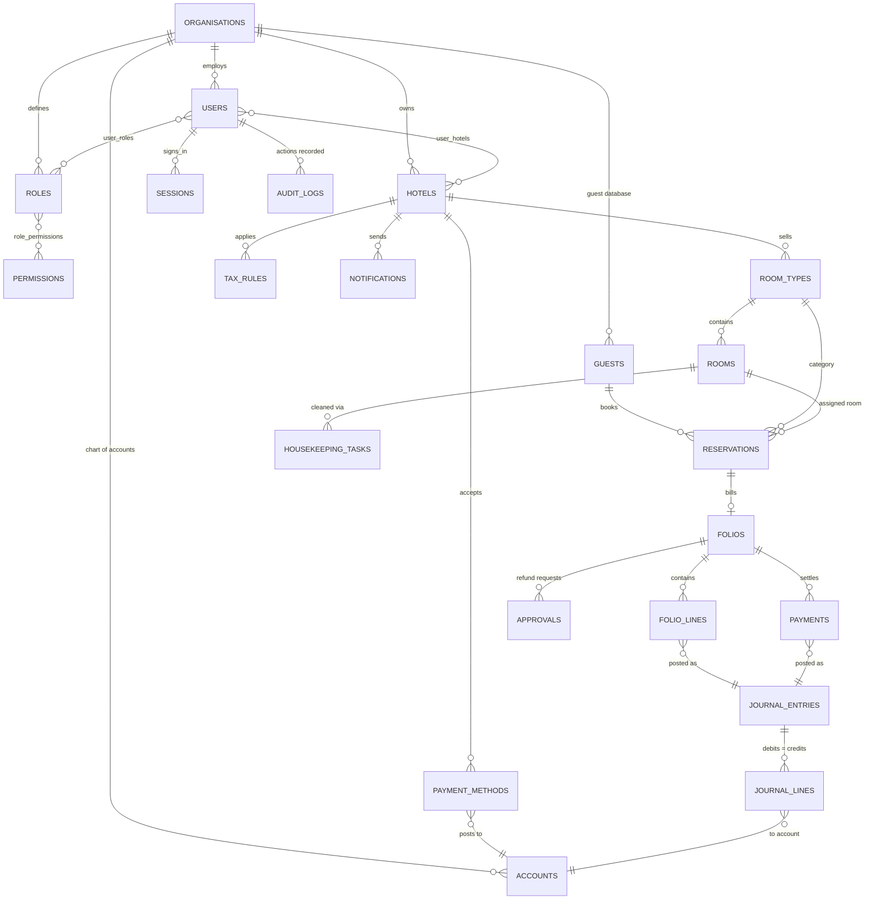

# Architecture

## Overview

```
Browser (React + TypeScript SPA, booking portal)
        │  HTTPS, JSON, Bearer JWT
        ▼
ASGI app (Starlette + Uvicorn)  ──  /api/*  REST endpoints, OpenAPI at /api/openapi.json
  ├─ http.py        routing, authentication, permission & hotel-scope checks, errors, rate limits
  ├─ modules/       auth · admin · properties · rooms · guests · reservations · frontoffice
  │                 accounting · housekeeping · dashboard · reports · booking (public)
  ├─ services.py    numbering, business date, tax engine, double-entry posting, notifications
  ├─ security.py    scrypt hashing, JWT, TOTP (RFC 6238)
  └─ db.py          thin SQL layer, one transaction per request action
        │
        ▼
PostgreSQL 16 (production)  /  SQLite (development & tests)
```

**Why Starlette rather than a heavier framework:** it is the ASGI core FastAPI is built on, has a tiny
dependency footprint, and keeps the business logic in plain, explicit SQL that maps one-to-one onto the
schema. The routing layer generates an OpenAPI 3 description from the route table, so documentation never
drifts from the code. The frontend is React 19 + TypeScript bundled with esbuild; styling is a bespoke CSS
design system (navy / champagne gold) instead of a utility framework, which keeps the bundle small.

## Key design decisions

| Concern | Decision |
|---|---|
| Money | Integers in minor units (kobo) everywhere — no floating-point rounding. Taxes use integer half-up rounding. |
| Double booking | Availability is checked inside the same database transaction that writes the booking; the room-type row (and room row) is locked with `SELECT … FOR UPDATE` on PostgreSQL; SQLite uses `BEGIN IMMEDIATE`. Overlap rule: `arrival < other.departure AND departure > other.arrival` (back-to-back stays allowed). |
| Overbooking | Allowed only with the `reservations.overbook` permission **and** a written reason; recorded in the audit trail. |
| Accounting integrity | Every charge, payment, refund and allowance posts a balanced journal entry (`post_journal` rejects unbalanced entries). Database triggers make `journal_lines` and `audit_logs` append-only and forbid deleting journal entries and folio lines; corrections are reversals. Each folio line links to its journal entry (traceability, FR-FIN-009). |
| Room charges | Posted per night by the night audit (reference `ROOM:<reservation>:<date>` prevents double posting); remaining nights post at check-out. Weekend (Fri/Sat) and corporate rates apply automatically; overrides need permission. |
| Room readiness | Check-out → room `dirty` + housekeeping task. Cleaning → `clean`. Only inspection → `inspected` (sellable). Check-in refuses rooms that are not inspected. |
| Refunds | Maker-checker: the requester cannot approve; approval re-validates the credit balance. |
| Third-party honesty | Messages are stored as `not_configured` when no provider exists; online-gateway payments return HTTP 501 until a gateway is configured. Nothing reports success that did not happen. |
| Multi-property | Organisation → hotels. Users have `all_hotels` or explicit hotel assignments; every hotel-scoped endpoint calls `ctx.check_hotel()`. Reports can be per hotel or consolidated. |
| Sensitive data | Guest identification fields are masked unless the user holds `guests.identity.view`; card data is never stored (only terminal approval references). |
| Sessions | Server-side session rows behind every JWT: logout, password change, suspension and admin revocation take effect immediately; idle timeout is enforced on each request. |

## Database

Migrations live in `backend/migrations` and are applied automatically on start-up (`python -m ehms.migrate`
to run manually, `--render postgresql` to print the DDL). Main tables:

| Group | Tables |
|---|---|
| Tenancy & access | organisations, hotels, departments, users, user_hotels, roles, permissions, role_permissions, user_roles, sessions, password_resets, login_attempts |
| Configuration | tax_rules, payment_methods, accounts (chart of accounts), sequences, system_settings |
| Rooms | room_types, rooms (occupancy × housekeeping status × service status) |
| Guests & stays | guests, reservations, folios, folio_lines, payments, approvals |
| Ledger | journal_entries, journal_lines |
| Operations | housekeeping_tasks, notifications |
| Control | audit_logs, schema_migrations |

All foreign keys, unique constraints (room numbers per hotel, reservation references, idempotency keys,
one folio per reservation) and check constraints (status enumerations, non-negative money, single-sided
journal lines, departure after arrival) are enforced by the database, not only by the application.

## Request lifecycle

1. `http.route()` parses JSON, applies rate limits (login, reset, public booking), authenticates the bearer
   token against the `sessions` table, loads permissions and hotel scope.
2. The handler runs in a thread pool inside `with get_db().tx() as c:` — one atomic transaction.
3. State changes write an `audit_logs` row (user, action, entity, before/after JSON, IP, user agent).
4. `ApiError` becomes a structured JSON error; integrity violations become HTTP 409.

## Extending

Add a module in `backend/ehms/modules/`, register routes with `@route(...)` and a permission from
`rbac.PERMISSIONS`, import it in `modules/__init__.py`, and add a migration file `000N_*.sql`. Frontend pages
go in `frontend/src/pages` and a menu entry in `App.tsx` gated by the same permission.

## Entity-relationship diagram (core)


