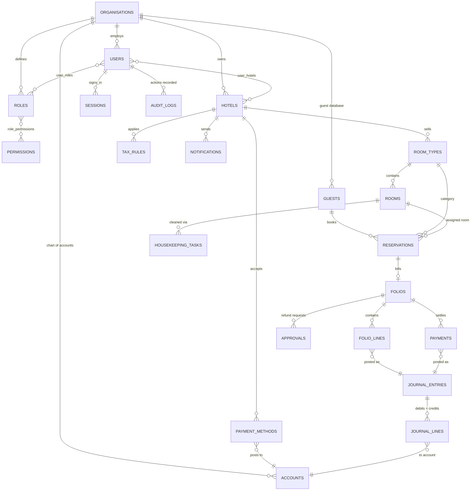

# Architecture

## Overview

```
Browser (React + TypeScript SPA, booking portal)
        │  HTTPS, JSON, Bearer JWT
        ▼
ASGI app (Starlette + Uvicorn)  ──  /api/*  REST endpoints, OpenAPI at /api/openapi.json
  ├─ http.py        routing, authentication, permission & hotel-scope checks, errors, rate limits
  ├─ modules/       auth · admin · properties · rooms · guests · reservations · frontoffice
  │                 accounting · housekeeping · dashboard · reports · booking (public)
  │                 pos (+ kitchen display) · inventory · procurement            (release 0.4)
  │                 online (gateways, promo codes) · finance · messaging          (release 0.5)
  │                 laundry · hr (+ self-service) · payroll                       (release 0.6)
  │                 maintenance (assets) · security · events                      (release 0.7)
  │                 crm (loyalty, complaints, feedback, campaigns) · sales (accounts,
  │                 rates, targets, pricing rules, revenue) · pricing engine        (release 0.8)
  ├─ gateways.py    Paystack / Flutterwave adapters, retrying HTTP client, integration log (0.5)
  ├─ worker.py      scheduled jobs + message delivery (in-process loop or separate) (0.5)
  ├─ stock.py       perpetual stock ledger (weighted average cost, FEFO batches)  (release 0.4)
  ├─ services.py    numbering, business date, tax engine, double-entry posting, notifications
  ├─ security.py    scrypt hashing, JWT, TOTP (RFC 6238)
  └─ db.py          thin SQL layer, one transaction per request action
        │
        ▼
PostgreSQL 16 (production)  /  SQLite (development & tests)
```

**Why Starlette rather than a heavier framework:** it is the ASGI core FastAPI is built on, has a tiny
dependency footprint, and keeps the business logic in plain, explicit SQL that maps one-to-one onto the
schema. The routing layer generates an OpenAPI 3 description from the route table, so documentation never
drifts from the code. The frontend is React 19 + TypeScript bundled with esbuild; styling is a bespoke CSS
design system (navy / champagne gold) instead of a utility framework, which keeps the bundle small.

## Key design decisions

| Concern | Decision |
|---|---|
| Money | Integers in minor units (kobo) everywhere — no floating-point rounding. Taxes use integer half-up rounding. |
| Double booking | Availability is checked inside the same database transaction that writes the booking; the room-type row (and room row) is locked with `SELECT … FOR UPDATE` on PostgreSQL; SQLite uses `BEGIN IMMEDIATE`. Overlap rule: `arrival < other.departure AND departure > other.arrival` (back-to-back stays allowed). |
| Overbooking | Allowed only with the `reservations.overbook` permission **and** a written reason; recorded in the audit trail. |
| Accounting integrity | Every charge, payment, refund and allowance posts a balanced journal entry (`post_journal` rejects unbalanced entries). Database triggers make `journal_lines` and `audit_logs` append-only and forbid deleting journal entries and folio lines; corrections are reversals. Each folio line links to its journal entry (traceability, FR-FIN-009). |
| Room charges | Posted per night by the night audit (reference `ROOM:<reservation>:<date>` prevents double posting); remaining nights post at check-out. Weekend (Fri/Sat) and corporate rates apply automatically; overrides need permission. |
| Room readiness | Check-out → room `dirty` + housekeeping task. Cleaning → `clean`. Only inspection → `inspected` (sellable). Check-in refuses rooms that are not inspected. |
| Refunds | Maker-checker: the requester cannot approve; approval re-validates the credit balance. |
| Third-party honesty | Messages are stored as `not_configured` when no provider exists; online-gateway payments return HTTP 501 until a gateway is configured. Nothing reports success that did not happen. |
| Multi-property | Organisation → hotels. Users have `all_hotels` or explicit hotel assignments; every hotel-scoped endpoint calls `ctx.check_hotel()`. Reports can be per hotel or consolidated. |
| Sensitive data | Guest identification fields are masked unless the user holds `guests.identity.view`; card data is never stored (only terminal approval references). |
| Stock quantities | Integer thousandths of the item's unit (`*_milli` columns) — 0.25 kg is exact on SQLite and PostgreSQL. |
| Stock valuation | Weighted average cost per item per store. Each stock level stores quantity **and** carrying value; an outflow removes value in proportion (all of it when the store empties), so the stock sub-ledger always equals the Inventory GL account (asserted by the tests). Batches with expiry dates are depleted first-expiry-first-out. `stock_movements` is append-only (DB triggers). |
| POS settlement | One transaction: validate tenders (only cash may be over-tendered), post one balanced journal (Dr tenders / guest ledger, Cr F&B revenue, service charge, VAT), write folio lines for room charges, deduct recipe ingredients (each menu item's own store or the outlet's) and post cost of sales. If any ingredient is short the whole settlement rolls back. |
| Procurement accounting | GRN: Dr Inventory / expense, Cr Goods Received Not Invoiced. Invoice approval: Dr GRNI (uninvoiced receipts) ± Purchase Price Variance, Cr Accounts Payable. Payment: Dr AP, Cr bank (net), Cr Withholding Tax Payable. Maker-checker on requisitions, POs (with a configurable high-value tier) and invoices. |
| Online payments | Transaction row first, then the provider call outside any DB transaction. Credit only after the provider's verify API confirms status, amount and currency; idempotency key `gw-<reference>`; webhook signatures checked with constant-time comparison; callers never trust webhook bodies. |
| Period close | `post_journal` refuses entries dated in a closed month, so every module (night audit, POS, procurement…) respects it automatically. |
| Messaging | Templates (built-in defaults + per-hotel overrides) rendered with a safe formatter; one queued row per channel; delivery with retries; reminders made idempotent by `job_runs`. |
| Payroll | Pure function `compute_payslip` (unit-testable) driven by a rules dictionary; each run snapshots its rules. Approval posts one balanced journal (gross + employer cost = net + every liability); payment and each remittance are separate journals guarded against duplicates. |
| HR privacy | Pay fields hidden without `hr.manage`/`payroll.view`; bank and statutory IDs masked without `hr.manage`/`payroll.pay`; confidential records only with `hr.records`; self-service limited to the user's own linked employee. |
| Venue clashes | Only tentative/confirmed events hold a venue; the check runs inside the status-change transaction (same overlap rule as rooms). |
| Event billing | A confirmed event gets its own folio (no room reservation), so deposits, invoices, refunds and the ledger reuse the front-office posting code. |
| Upgrades | Migrations apply on start-up. Permissions introduced by a release are granted once to existing system roles (`rbac.INTRODUCED`, marker in `system_settings`); missing ledger accounts are added. |
| Sessions | Server-side session rows behind every JWT: logout, password change, suspension and admin revocation take effect immediately; idle timeout is enforced on each request. |

## Database

Migrations live in `backend/migrations` and are applied automatically on start-up (`python -m ehms.migrate`
to run manually, `--render postgresql` to print the DDL). Main tables:

| Group | Tables |
|---|---|
| Tenancy & access | organisations, hotels, departments, users, user_hotels, roles, permissions, role_permissions, user_roles, sessions, password_resets, login_attempts |
| Configuration | tax_rules, payment_methods, accounts (chart of accounts), sequences, system_settings |
| Rooms | room_types, rooms (occupancy × housekeeping status × service status) |
| Guests & stays | guests, reservations, folios, folio_lines, payments, approvals |
| Ledger | journal_entries, journal_lines |
| Operations | housekeeping_tasks, notifications |
| Inventory (0.4) | stores, inventory_items, stock_levels, stock_batches, stock_movements, stock_requisitions(+_lines), stock_counts(+_lines) |
| POS (0.4) | outlets, pos_tables, menu_categories, menu_items, recipe_lines, cashier_shifts, pos_orders, pos_order_items, pos_payments |
| Payments & finance (0.5) | gateway_transactions, integration_logs, promo_codes, accounting_periods, bank_statement_lines, budget_lines, expense_claims |
| Messaging (0.5) | notification_templates, job_runs (+ notifications.read_at / attempts) |
| CRM, sales & revenue (0.8) | corporate_accounts, corporate_rates, sales_targets, rate_seasons, rate_rules, competitor_rates, loyalty_accounts, loyalty_transactions, complaints, complaint_updates, feedback, campaigns, campaign_recipients; reservations.corporate_account_id and locked_rates |
| Maintenance, security & events (0.7) | assets, asset_depreciation, maintenance_schedules, work_orders(+_parts, _notes), security_incidents, incident_notes, visitors, lost_found, emergency_contacts, access_events, venues, events, event_venues, event_items, event_costs, event_staff |
| Laundry, HR & payroll (0.6) | laundry_prices, laundry_orders(+_items), employees, shift_templates, shift_assignments, attendance, leave_types, leave_requests, hr_records, employee_loans, payroll_runs, payslips, payroll_adjustments |
| Procurement (0.4) | suppliers, purchase_requisitions(+_lines), supplier_quotes(+_lines), purchase_orders(+_lines), goods_receipts(+_lines), supplier_invoices, supplier_payments |
| Control | audit_logs, schema_migrations |

All foreign keys, unique constraints (room numbers per hotel, reservation references, idempotency keys,
one folio per reservation) and check constraints (status enumerations, non-negative money, single-sided
journal lines, departure after arrival) are enforced by the database, not only by the application.

## Request lifecycle

1. `http.route()` parses JSON, applies rate limits (login, reset, public booking), authenticates the bearer
   token against the `sessions` table, loads permissions and hotel scope.
2. The handler runs in a thread pool inside `with get_db().tx() as c:` — one atomic transaction.
3. State changes write an `audit_logs` row (user, action, entity, before/after JSON, IP, user agent).
4. `ApiError` becomes a structured JSON error; integrity violations become HTTP 409.

## Extending

Add a module in `backend/ehms/modules/`, register routes with `@route(...)` and a permission from
`rbac.PERMISSIONS`, import it in `modules/__init__.py`, and add a migration file `000N_*.sql`. Frontend pages
go in `frontend/src/pages` and a menu entry in `App.tsx` gated by the same permission.

## Entity-relationship diagram (core)



## Entity-relationship diagram (release 0.4: POS, inventory, procurement)

```mermaid
erDiagram
  HOTELS ||--o{ STORES : has
  HOTELS ||--o{ INVENTORY_ITEMS : catalogues
  INVENTORY_ITEMS ||--o{ STOCK_LEVELS : "balance per store"
  STORES ||--o{ STOCK_LEVELS : holds
  INVENTORY_ITEMS ||--o{ STOCK_BATCHES : "batches / expiry"
  INVENTORY_ITEMS ||--o{ STOCK_MOVEMENTS : "append-only history"
  STOCK_MOVEMENTS }o--o| JOURNAL_ENTRIES : "valued in"
  STORES ||--o{ STOCK_REQUISITIONS : "issues from"
  STORES ||--o{ STOCK_COUNTS : counted
  HOTELS ||--o{ OUTLETS : runs
  OUTLETS }o--o| STORES : "issuing store"
  OUTLETS ||--o{ POS_TABLES : seats
  MENU_CATEGORIES ||--o{ MENU_ITEMS : groups
  MENU_ITEMS ||--o{ RECIPE_LINES : "recipe"
  RECIPE_LINES }o--|| INVENTORY_ITEMS : consumes
  OUTLETS ||--o{ CASHIER_SHIFTS : "cash drawer"
  OUTLETS ||--o{ POS_ORDERS : sells
  POS_TABLES ||--o{ POS_ORDERS : "dine-in"
  RESERVATIONS ||--o{ POS_ORDERS : "room service"
  POS_ORDERS ||--o{ POS_ORDER_ITEMS : contains
  POS_ORDERS ||--o{ POS_PAYMENTS : "settled by"
  POS_PAYMENTS }o--o| FOLIO_LINES : "charge to room"
  POS_ORDERS }o--o| JOURNAL_ENTRIES : "sale + cost of sales"
  ORGANISATIONS ||--o{ SUPPLIERS : "supplier register"
  PURCHASE_REQUISITIONS ||--o{ SUPPLIER_QUOTES : "quotations"
  SUPPLIERS ||--o{ PURCHASE_ORDERS : "orders"
  PURCHASE_REQUISITIONS ||--o{ PURCHASE_ORDERS : "ordered as"
  PURCHASE_ORDERS ||--o{ GOODS_RECEIPTS : "received via GRN"
  PURCHASE_ORDERS ||--o{ SUPPLIER_INVOICES : "matched to"
  SUPPLIER_INVOICES ||--o{ SUPPLIER_PAYMENTS : "paid by"
  GOODS_RECEIPTS }o--|| JOURNAL_ENTRIES : "Dr Inventory / Cr GRNI"
  SUPPLIER_INVOICES }o--o| JOURNAL_ENTRIES : "Dr GRNI / Cr AP"
  SUPPLIER_PAYMENTS }o--|| JOURNAL_ENTRIES : "Dr AP / Cr Bank, WHT"
```


