# Data dictionary — EHMS 1.3.0

Generated from the migrations by `python -m ehms.datadict`; do not edit by hand. Types are shown as they are in PostgreSQL (SQLite uses compatible storage classes). Money columns hold whole kobo (minor units); `*_milli` quantities hold thousandths.

**146 tables**, 1679 columns, 417 foreign keys.

## Contents

- **Organisation, users and security**: [audit_logs](#audit_logs), [backups](#backups), [departments](#departments), [hotels](#hotels), [job_runs](#job_runs), [login_attempts](#login_attempts), [organisations](#organisations), [password_resets](#password_resets), [permissions](#permissions), [role_permissions](#role_permissions), [roles](#roles), [sequences](#sequences), [sessions](#sessions), [system_settings](#system_settings), [user_hotels](#user_hotels), [user_roles](#user_roles), [users](#users)
- **Rooms, guests and reservations**: [cancellation_policies](#cancellation_policies), [group_block_rooms](#group_block_rooms), [group_blocks](#group_blocks), [guests](#guests), [promo_codes](#promo_codes), [rate_rules](#rate_rules), [rate_seasons](#rate_seasons), [referral_codes](#referral_codes), [referrals](#referrals), [reservations](#reservations), [room_type_media](#room_type_media), [room_types](#room_types), [rooms](#rooms), [wake_up_calls](#wake_up_calls)
- **Folios, payments and billing**: [approvals](#approvals), [customer_notes](#customer_notes), [exchange_rates](#exchange_rates), [folio_lines](#folio_lines), [folios](#folios), [gateway_transactions](#gateway_transactions), [payment_methods](#payment_methods), [payments](#payments)
- **Accounting and finance**: [accounting_periods](#accounting_periods), [accounts](#accounts), [bank_statement_lines](#bank_statement_lines), [budget_lines](#budget_lines), [expense_claims](#expense_claims), [journal_entries](#journal_entries), [journal_lines](#journal_lines), [petty_cash_entries](#petty_cash_entries), [petty_cash_funds](#petty_cash_funds), [tax_rules](#tax_rules)
- **Restaurant, bar and kitchen**: [cashier_shifts](#cashier_shifts), [menu_categories](#menu_categories), [menu_items](#menu_items), [outlets](#outlets), [pos_order_items](#pos_order_items), [pos_orders](#pos_orders), [pos_payments](#pos_payments), [pos_tables](#pos_tables), [recipe_lines](#recipe_lines), [table_reservations](#table_reservations)
- **Inventory and procurement**: [goods_receipt_lines](#goods_receipt_lines), [goods_receipts](#goods_receipts), [inventory_items](#inventory_items), [purchase_order_lines](#purchase_order_lines), [purchase_orders](#purchase_orders), [purchase_requisition_lines](#purchase_requisition_lines), [purchase_requisitions](#purchase_requisitions), [purchase_return_lines](#purchase_return_lines), [purchase_returns](#purchase_returns), [stock_batches](#stock_batches), [stock_count_lines](#stock_count_lines), [stock_counts](#stock_counts), [stock_levels](#stock_levels), [stock_movements](#stock_movements), [stock_requisition_lines](#stock_requisition_lines), [stock_requisitions](#stock_requisitions), [stores](#stores), [supplier_invoices](#supplier_invoices), [supplier_payments](#supplier_payments), [supplier_quote_lines](#supplier_quote_lines), [supplier_quotes](#supplier_quotes), [suppliers](#suppliers)
- **Housekeeping and laundry**: [housekeeping_tasks](#housekeeping_tasks), [laundry_order_items](#laundry_order_items), [laundry_orders](#laundry_orders), [laundry_prices](#laundry_prices)
- **Human resources and payroll**: [applicant_events](#applicant_events), [applicants](#applicants), [appraisals](#appraisals), [attendance](#attendance), [employee_history](#employee_history), [employee_loans](#employee_loans), [employees](#employees), [hr_records](#hr_records), [job_openings](#job_openings), [leave_adjustments](#leave_adjustments), [leave_requests](#leave_requests), [leave_types](#leave_types), [payroll_adjustments](#payroll_adjustments), [payroll_runs](#payroll_runs), [payslips](#payslips), [public_holidays](#public_holidays), [shift_assignments](#shift_assignments), [shift_templates](#shift_templates), [staff_requests](#staff_requests), [trainings](#trainings), [welfare_records](#welfare_records)
- **Maintenance, security and events**: [access_events](#access_events), [asset_depreciation](#asset_depreciation), [assets](#assets), [emergency_contacts](#emergency_contacts), [event_costs](#event_costs), [event_items](#event_items), [event_staff](#event_staff), [event_venues](#event_venues), [events](#events), [incident_notes](#incident_notes), [lost_found](#lost_found), [maintenance_schedules](#maintenance_schedules), [security_incidents](#security_incidents), [venues](#venues), [visitors](#visitors), [work_order_notes](#work_order_notes), [work_order_parts](#work_order_parts), [work_orders](#work_orders)
- **Guest relations, sales and revenue**: [campaign_recipients](#campaign_recipients), [campaigns](#campaigns), [competitor_rates](#competitor_rates), [complaint_updates](#complaint_updates), [complaints](#complaints), [corporate_accounts](#corporate_accounts), [corporate_rates](#corporate_rates), [feedback](#feedback), [loyalty_accounts](#loyalty_accounts), [loyalty_transactions](#loyalty_transactions), [sales_targets](#sales_targets)
- **Intelligence, documents, messaging and website**: [ai_interactions](#ai_interactions), [anomaly_flags](#anomaly_flags), [document_access_log](#document_access_log), [documents](#documents), [integration_logs](#integration_logs), [notification_templates](#notification_templates), [notifications](#notifications), [report_schedules](#report_schedules), [website_content](#website_content), [website_enquiries](#website_enquiries), [website_media](#website_media)

## Organisation, users and security

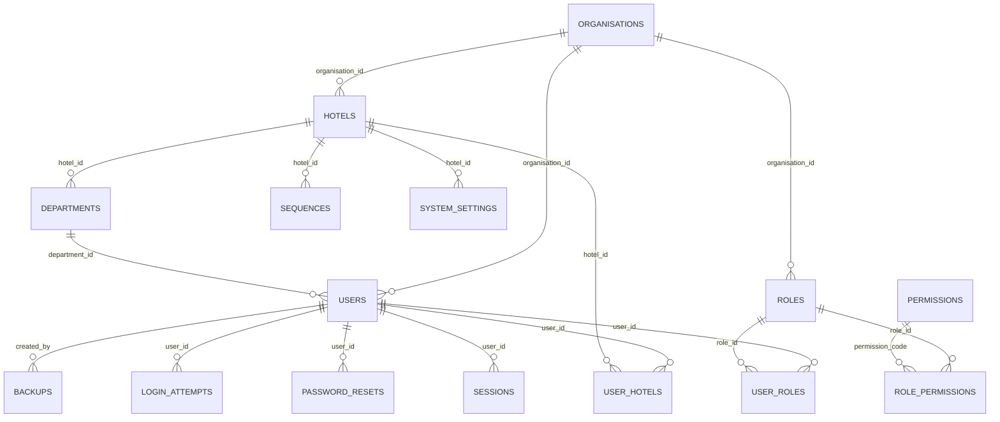

### audit_logs

Defined in `0001_core.sql`.

| Column | Type | Null | Default | Key / reference |
|---|---|---|---|---|
| id | INTEGER | no |  | PK |
| organisation_id | INTEGER | yes |  |  |
| hotel_id | INTEGER | yes |  |  |
| user_id | INTEGER | yes |  |  |
| action | VARCHAR(80) | no |  |  |
| entity | VARCHAR(60) | yes |  |  |
| entity_id | VARCHAR(60) | yes |  |  |
| reference | VARCHAR(80) | yes |  |  |
| old_value | TEXT | yes |  |  |
| new_value | TEXT | yes |  |  |
| ip | VARCHAR(64) | yes |  |  |
| user_agent | VARCHAR(300) | yes |  |  |
| created_at | TEXT | no |  |  |

### backups

Defined in `0012_requirements_completion.sql`.

| Column | Type | Null | Default | Key / reference |
|---|---|---|---|---|
| id | INTEGER | no |  | PK |
| filename | VARCHAR(200) | no |  |  |
| kind | VARCHAR(10) | no |  |  |
| status | VARCHAR(10) | no |  |  |
| size_bytes | INTEGER | yes |  |  |
| tables_count | INTEGER | yes |  |  |
| rows_count | INTEGER | yes |  |  |
| checksum | VARCHAR(64) | yes |  |  |
| verified | INTEGER | no | 0 |  |
| error | VARCHAR(500) | yes |  |  |
| created_by | INTEGER | yes |  | → users |
| created_at | TEXT | no |  |  |

### departments

Defined in `0001_core.sql`. Unique: (hotel_id, code).

| Column | Type | Null | Default | Key / reference |
|---|---|---|---|---|
| id | INTEGER | no |  | PK |
| hotel_id | INTEGER | no |  | → hotels |
| code | VARCHAR(30) | no |  |  |
| name | VARCHAR(100) | no |  |  |

### hotels

Defined in `0001_core.sql`. Unique: (organisation_id, code).

| Column | Type | Null | Default | Key / reference |
|---|---|---|---|---|
| id | INTEGER | no |  | PK |
| organisation_id | INTEGER | no |  | → organisations |
| code | VARCHAR(30) | no |  |  |
| name | VARCHAR(200) | no |  |  |
| legal_name | VARCHAR(200) | yes |  |  |
| registration_number | VARCHAR(100) | yes |  |  |
| category | VARCHAR(50) | yes | 'hotel' |  |
| star_rating | INTEGER | yes |  |  |
| address | TEXT | yes |  |  |
| city | VARCHAR(100) | yes |  |  |
| state | VARCHAR(100) | yes |  |  |
| country | VARCHAR(100) | yes | 'Nigeria' |  |
| phone | VARCHAR(50) | yes |  |  |
| email | VARCHAR(200) | yes |  |  |
| website | VARCHAR(200) | yes |  |  |
| emergency_contact | VARCHAR(200) | yes |  |  |
| floors | INTEGER | yes |  |  |
| timezone | VARCHAR(64) | no | 'Africa/Lagos' |  |
| currency | CHAR(3) | no | 'NGN' |  |
| check_in_time | VARCHAR(5) | no | '14:00' |  |
| check_out_time | VARCHAR(5) | no | '12:00' |  |
| cancellation_policy | TEXT | yes |  |  |
| reservation_policy | TEXT | yes |  |  |
| terms | TEXT | yes |  |  |
| amenities | TEXT | yes |  |  |
| service_charge_bp | INTEGER | no | 0 |  |
| business_date | TEXT | yes |  |  |
| active | INTEGER | no | 1 |  |
| created_at | TEXT | no |  |  |

### job_runs

Defined in `0004_payments_finance_messaging.sql`. Unique: (job, run_key).

| Column | Type | Null | Default | Key / reference |
|---|---|---|---|---|
| id | INTEGER | no |  | PK |
| job | VARCHAR(40) | no |  |  |
| run_key | VARCHAR(120) | no |  |  |
| created_at | TEXT | no |  |  |

### login_attempts

Defined in `0001_core.sql`.

| Column | Type | Null | Default | Key / reference |
|---|---|---|---|---|
| id | INTEGER | no |  | PK |
| email | VARCHAR(200) | yes |  |  |
| user_id | INTEGER | yes |  | → users |
| success | INTEGER | no |  |  |
| reason | VARCHAR(100) | yes |  |  |
| ip | VARCHAR(64) | yes |  |  |
| user_agent | VARCHAR(300) | yes |  |  |
| created_at | TEXT | no |  |  |

### organisations

Defined in `0001_core.sql`. Unique: (code).

| Column | Type | Null | Default | Key / reference |
|---|---|---|---|---|
| id | INTEGER | no |  | PK |
| code | VARCHAR(30) | no |  |  |
| name | VARCHAR(200) | no |  |  |
| created_at | TEXT | no |  |  |

### password_resets

Defined in `0001_core.sql`. Unique: (token_hash).

| Column | Type | Null | Default | Key / reference |
|---|---|---|---|---|
| id | INTEGER | no |  | PK |
| user_id | INTEGER | no |  | → users |
| token_hash | VARCHAR(128) | no |  |  |
| expires_at | TEXT | no |  |  |
| used_at | TEXT | yes |  |  |
| created_at | TEXT | no |  |  |

### permissions

Defined in `0001_core.sql`.

| Column | Type | Null | Default | Key / reference |
|---|---|---|---|---|
| code | VARCHAR(80) | no |  | PK |
| module | VARCHAR(50) | no |  |  |
| description | VARCHAR(200) | no |  |  |

### role_permissions

Defined in `0001_core.sql`.

| Column | Type | Null | Default | Key / reference |
|---|---|---|---|---|
| role_id | INTEGER | no |  | PK |
| permission_code | VARCHAR(80) | no |  | PK |

### roles

Defined in `0001_core.sql`. Unique: (organisation_id, code).

| Column | Type | Null | Default | Key / reference |
|---|---|---|---|---|
| id | INTEGER | no |  | PK |
| organisation_id | INTEGER | yes |  | → organisations |
| code | VARCHAR(60) | no |  |  |
| name | VARCHAR(100) | no |  |  |
| description | VARCHAR(300) | yes |  |  |
| is_system | INTEGER | no | 0 |  |

### sequences

Defined in `0001_core.sql`. Unique: (hotel_id, name).

| Column | Type | Null | Default | Key / reference |
|---|---|---|---|---|
| id | INTEGER | no |  | PK |
| hotel_id | INTEGER | no |  | → hotels |
| name | VARCHAR(40) | no |  |  |
| next_value | INTEGER | no | 1 |  |

### sessions

Defined in `0001_core.sql`. Unique: (jti).

| Column | Type | Null | Default | Key / reference |
|---|---|---|---|---|
| id | INTEGER | no |  | PK |
| user_id | INTEGER | no |  | → users |
| jti | VARCHAR(64) | no |  |  |
| ip | VARCHAR(64) | yes |  |  |
| user_agent | VARCHAR(300) | yes |  |  |
| created_at | TEXT | no |  |  |
| last_seen_at | TEXT | no |  |  |
| expires_at | TEXT | no |  |  |
| revoked_at | TEXT | yes |  |  |
| mfa_pending | INTEGER | no | 0 |  |

### system_settings

Defined in `0001_core.sql`. Unique: (hotel_id, key).

| Column | Type | Null | Default | Key / reference |
|---|---|---|---|---|
| id | INTEGER | no |  | PK |
| hotel_id | INTEGER | yes |  | → hotels |
| key | VARCHAR(80) | no |  |  |
| value | TEXT | yes |  |  |

### user_hotels

Defined in `0001_core.sql`.

| Column | Type | Null | Default | Key / reference |
|---|---|---|---|---|
| user_id | INTEGER | no |  | PK |
| hotel_id | INTEGER | no |  | PK |

### user_roles

Defined in `0001_core.sql`.

| Column | Type | Null | Default | Key / reference |
|---|---|---|---|---|
| user_id | INTEGER | no |  | PK |
| role_id | INTEGER | no |  | PK |

### users

Defined in `0001_core.sql`. Unique: (email).

| Column | Type | Null | Default | Key / reference |
|---|---|---|---|---|
| id | INTEGER | no |  | PK |
| organisation_id | INTEGER | yes |  | → organisations |
| email | VARCHAR(200) | no |  |  |
| full_name | VARCHAR(200) | no |  |  |
| phone | VARCHAR(50) | yes |  |  |
| department_id | INTEGER | yes |  | → departments |
| password_hash | VARCHAR(300) | no |  |  |
| status | VARCHAR(20) | no | 'active' |  |
| all_hotels | INTEGER | no | 0 |  |
| mfa_enabled | INTEGER | no | 0 |  |
| mfa_secret | VARCHAR(64) | yes |  |  |
| failed_logins | INTEGER | no | 0 |  |
| locked_until | TEXT | yes |  |  |
| last_login_at | TEXT | yes |  |  |
| password_changed_at | TEXT | yes |  |  |
| must_change_password | INTEGER | no | 0 |  |
| created_at | TEXT | no |  |  |
| language | VARCHAR(5) | no | 'en' |  |

## Rooms, guests and reservations

```mermaid
erDiagram
    HOTELS ||--o{ CANCELLATION_POLICIES : "hotel_id"
    ROOM_TYPES ||--o{ GROUP_BLOCK_ROOMS : "room_type_id"
    GROUP_BLOCKS ||--o{ GROUP_BLOCK_ROOMS : "block_id"
    USERS ||--o{ GROUP_BLOCKS : "created_by"
    FOLIOS ||--o{ GROUP_BLOCKS : "master_folio_id"
    GUESTS ||--o{ GROUP_BLOCKS : "contact_guest_id"
    CORPORATE_ACCOUNTS ||--o{ GROUP_BLOCKS : "corporate_account_id"
    HOTELS ||--o{ GROUP_BLOCKS : "hotel_id"
    ORGANISATIONS ||--o{ GUESTS : "organisation_id"
    USERS ||--o{ PROMO_CODES : "created_by"
    ROOM_TYPES ||--o{ PROMO_CODES : "room_type_id"
    HOTELS ||--o{ PROMO_CODES : "hotel_id"
    USERS ||--o{ RATE_RULES : "approved_by"
    USERS ||--o{ RATE_RULES : "created_by"
    ROOM_TYPES ||--o{ RATE_RULES : "room_type_id"
    HOTELS ||--o{ RATE_RULES : "hotel_id"
    USERS ||--o{ RATE_SEASONS : "created_by"
    ROOM_TYPES ||--o{ RATE_SEASONS : "room_type_id"
    HOTELS ||--o{ RATE_SEASONS : "hotel_id"
    GUESTS ||--o{ REFERRAL_CODES : "guest_id"
    RESERVATIONS ||--o{ REFERRALS : "reservation_id"
    GUESTS ||--o{ REFERRALS : "referred_guest_id"
    GUESTS ||--o{ REFERRALS : "referrer_guest_id"
    HOTELS ||--o{ REFERRALS : "hotel_id"
    GROUP_BLOCKS ||--o{ RESERVATIONS : "group_block_id"
    USERS ||--o{ RESERVATIONS : "fee_waived_by"
    CANCELLATION_POLICIES ||--o{ RESERVATIONS : "cancellation_policy_id"
    CORPORATE_ACCOUNTS ||--o{ RESERVATIONS : "corporate_account_id"
    USERS ||--o{ RESERVATIONS : "created_by"
    ROOMS ||--o{ RESERVATIONS : "room_id"
    ROOM_TYPES ||--o{ RESERVATIONS : "room_type_id"
    GUESTS ||--o{ RESERVATIONS : "guest_id"
    HOTELS ||--o{ RESERVATIONS : "hotel_id"
    USERS ||--o{ ROOM_TYPE_MEDIA : "created_by"
    ROOM_TYPES ||--o{ ROOM_TYPE_MEDIA : "room_type_id"
    HOTELS ||--o{ ROOM_TYPES : "hotel_id"
    ROOM_TYPES ||--o{ ROOMS : "room_type_id"
    HOTELS ||--o{ ROOMS : "hotel_id"
    USERS ||--o{ WAKE_UP_CALLS : "created_by"
    USERS ||--o{ WAKE_UP_CALLS : "done_by"
    RESERVATIONS ||--o{ WAKE_UP_CALLS : "reservation_id"
    HOTELS ||--o{ WAKE_UP_CALLS : "hotel_id"
```

### cancellation_policies

Defined in `0009_groups_notes_fx_recruitment.sql`.

| Column | Type | Null | Default | Key / reference |
|---|---|---|---|---|
| id | INTEGER | no |  | PK |
| hotel_id | INTEGER | no |  | → hotels |
| name | VARCHAR(100) | no |  |  |
| free_until_hours | INTEGER | no | 24 |  |
| fee_type | VARCHAR(12) | no | 'first_night' |  |
| fee_value | INTEGER | no | 0 |  |
| no_show_fee_type | VARCHAR(12) | no | 'first_night' |  |
| no_show_fee_value | INTEGER | no | 0 |  |
| is_default | INTEGER | no | 0 |  |
| active | INTEGER | no | 1 |  |
| created_at | TEXT | no |  |  |

### group_block_rooms

Defined in `0009_groups_notes_fx_recruitment.sql`. Unique: (block_id, room_type_id).

| Column | Type | Null | Default | Key / reference |
|---|---|---|---|---|
| id | INTEGER | no |  | PK |
| block_id | INTEGER | no |  | → group_blocks |
| room_type_id | INTEGER | no |  | → room_types |
| rooms | INTEGER | no |  |  |
| rate | INTEGER | no |  |  |

### group_blocks

Defined in `0009_groups_notes_fx_recruitment.sql`. Unique: (hotel_id, code).

| Column | Type | Null | Default | Key / reference |
|---|---|---|---|---|
| id | INTEGER | no |  | PK |
| hotel_id | INTEGER | no |  | → hotels |
| code | VARCHAR(30) | no |  |  |
| name | VARCHAR(200) | no |  |  |
| corporate_account_id | INTEGER | yes |  | → corporate_accounts |
| contact_guest_id | INTEGER | yes |  | → guests |
| arrival | TEXT | no |  |  |
| departure | TEXT | no |  |  |
| cutoff_date | TEXT | no |  |  |
| status | VARCHAR(12) | no | 'tentative' |  |
| billing | VARCHAR(12) | no | 'individual' |  |
| master_folio_id | INTEGER | yes |  | → folios |
| notes | TEXT | yes |  |  |
| created_by | INTEGER | yes |  | → users |
| created_at | TEXT | no |  |  |
| released_at | TEXT | yes |  |  |

### guests

Defined in `0001_core.sql`.

| Column | Type | Null | Default | Key / reference |
|---|---|---|---|---|
| id | INTEGER | no |  | PK |
| organisation_id | INTEGER | no |  | → organisations |
| first_name | VARCHAR(100) | no |  |  |
| last_name | VARCHAR(100) | no |  |  |
| email | VARCHAR(200) | yes |  |  |
| phone | VARCHAR(50) | yes |  |  |
| nationality | VARCHAR(100) | yes |  |  |
| address | TEXT | yes |  |  |
| date_of_birth | TEXT | yes |  |  |
| id_type | VARCHAR(50) | yes |  |  |
| id_number | VARCHAR(100) | yes |  |  |
| company | VARCHAR(200) | yes |  |  |
| preferences | TEXT | yes |  |  |
| vip | INTEGER | no | 0 |  |
| marketing_consent | INTEGER | no | 0 |  |
| notes | TEXT | yes |  |  |
| created_at | TEXT | no |  |  |

### promo_codes

Defined in `0004_payments_finance_messaging.sql`. Unique: (hotel_id, code).

| Column | Type | Null | Default | Key / reference |
|---|---|---|---|---|
| id | INTEGER | no |  | PK |
| hotel_id | INTEGER | no |  | → hotels |
| code | VARCHAR(40) | no |  |  |
| description | VARCHAR(200) | yes |  |  |
| discount_type | VARCHAR(10) | no |  |  |
| value | INTEGER | no |  |  |
| valid_from | TEXT | no |  |  |
| valid_to | TEXT | no |  |  |
| min_nights | INTEGER | no | 1 |  |
| max_uses | INTEGER | yes |  |  |
| uses | INTEGER | no | 0 |  |
| room_type_id | INTEGER | yes |  | → room_types |
| active | INTEGER | no | 1 |  |
| created_by | INTEGER | yes |  | → users |
| created_at | TEXT | no |  |  |

### rate_rules

Defined in `0007_crm_sales_revenue.sql`.

| Column | Type | Null | Default | Key / reference |
|---|---|---|---|---|
| id | INTEGER | no |  | PK |
| hotel_id | INTEGER | no |  | → hotels |
| name | VARCHAR(100) | no |  |  |
| room_type_id | INTEGER | yes |  | → room_types |
| min_occupancy_pct | INTEGER | no |  |  |
| max_occupancy_pct | INTEGER | no | 100 |  |
| adjustment_bp | INTEGER | no |  |  |
| status | VARCHAR(20) | no | 'pending_approval' |  |
| created_by | INTEGER | no |  | → users |
| approved_by | INTEGER | yes |  | → users |
| created_at | TEXT | no |  |  |
| approved_at | TEXT | yes |  |  |

### rate_seasons

Defined in `0007_crm_sales_revenue.sql`.

| Column | Type | Null | Default | Key / reference |
|---|---|---|---|---|
| id | INTEGER | no |  | PK |
| hotel_id | INTEGER | no |  | → hotels |
| name | VARCHAR(100) | no |  |  |
| start_date | TEXT | no |  |  |
| end_date | TEXT | no |  |  |
| room_type_id | INTEGER | yes |  | → room_types |
| adjustment_bp | INTEGER | no |  |  |
| active | INTEGER | no | 1 |  |
| created_by | INTEGER | yes |  | → users |

### referral_codes

Defined in `0012_requirements_completion.sql`. Unique: (code), (guest_id).

| Column | Type | Null | Default | Key / reference |
|---|---|---|---|---|
| id | INTEGER | no |  | PK |
| guest_id | INTEGER | no |  | → guests |
| code | VARCHAR(20) | no |  |  |
| created_at | TEXT | no |  |  |

### referrals

Defined in `0012_requirements_completion.sql`. Unique: (reservation_id).

| Column | Type | Null | Default | Key / reference |
|---|---|---|---|---|
| id | INTEGER | no |  | PK |
| hotel_id | INTEGER | no |  | → hotels |
| referrer_guest_id | INTEGER | no |  | → guests |
| referred_guest_id | INTEGER | no |  | → guests |
| reservation_id | INTEGER | no |  | → reservations |
| status | VARCHAR(10) | no | 'pending' |  |
| points | INTEGER | no | 0 |  |
| created_at | TEXT | no |  |  |
| rewarded_at | TEXT | yes |  |  |

### reservations

Defined in `0001_core.sql`. Unique: (reference).

| Column | Type | Null | Default | Key / reference |
|---|---|---|---|---|
| id | INTEGER | no |  | PK |
| hotel_id | INTEGER | no |  | → hotels |
| reference | VARCHAR(30) | no |  |  |
| guest_id | INTEGER | no |  | → guests |
| status | VARCHAR(20) | no |  |  |
| booking_type | VARCHAR(20) | no | 'individual' |  |
| source | VARCHAR(30) | no | 'front_desk' |  |
| arrival | TEXT | no |  |  |
| departure | TEXT | no |  |  |
| adults | INTEGER | no | 1 |  |
| children | INTEGER | no | 0 |  |
| room_type_id | INTEGER | no |  | → room_types |
| room_id | INTEGER | yes |  | → rooms |
| nightly_rate | INTEGER | no |  |  |
| rate_overridden | INTEGER | no | 0 |  |
| discount_amount | INTEGER | no | 0 |  |
| deposit_required | INTEGER | no | 0 |  |
| company_name | VARCHAR(200) | yes |  |  |
| group_name | VARCHAR(200) | yes |  |  |
| special_requests | TEXT | yes |  |  |
| notes | TEXT | yes |  |  |
| created_by | INTEGER | yes |  | → users |
| created_at | TEXT | no |  |  |
| updated_at | TEXT | no |  |  |
| cancelled_at | TEXT | yes |  |  |
| cancel_reason | VARCHAR(300) | yes |  |  |
| checked_in_at | TEXT | yes |  |  |
| checked_out_at | TEXT | yes |  |  |
| promo_code | VARCHAR(40) | yes |  |  |
| corporate_account_id | INTEGER | yes |  | → corporate_accounts |
| locked_rates | TEXT | yes |  |  |
| cancellation_policy_id | INTEGER | yes |  | → cancellation_policies |
| cancellation_fee | INTEGER | yes |  |  |
| fee_waived_by | INTEGER | yes |  | → users |
| fee_waive_reason | VARCHAR(300) | yes |  |  |
| group_block_id | INTEGER | yes |  | → group_blocks |
| early_check_in | INTEGER | no | 0 |  |
| late_check_out_until | VARCHAR(5) | yes |  |  |

### room_type_media

Defined in `0012_requirements_completion.sql`.

| Column | Type | Null | Default | Key / reference |
|---|---|---|---|---|
| id | INTEGER | no |  | PK |
| room_type_id | INTEGER | no |  | → room_types |
| kind | VARCHAR(10) | no |  |  |
| filename | VARCHAR(200) | yes |  |  |
| content_type | VARCHAR(50) | yes |  |  |
| url | VARCHAR(500) | yes |  |  |
| caption | VARCHAR(150) | yes |  |  |
| sort_order | INTEGER | no | 0 |  |
| created_by | INTEGER | no |  | → users |
| created_at | TEXT | no |  |  |

### room_types

Defined in `0001_core.sql`. Unique: (hotel_id, code).

| Column | Type | Null | Default | Key / reference |
|---|---|---|---|---|
| id | INTEGER | no |  | PK |
| hotel_id | INTEGER | no |  | → hotels |
| code | VARCHAR(20) | no |  |  |
| name | VARCHAR(100) | no |  |  |
| description | TEXT | yes |  |  |
| max_occupancy | INTEGER | no | 2 |  |
| beds | INTEGER | no | 1 |  |
| bed_config | VARCHAR(100) | yes |  |  |
| size_sqm | INTEGER | yes |  |  |
| amenities | TEXT | yes |  |  |
| base_rate | INTEGER | no |  |  |
| weekend_rate | INTEGER | yes |  |  |
| corporate_rate | INTEGER | yes |  |  |
| extra_person_charge | INTEGER | no | 0 |  |
| image_url | VARCHAR(300) | yes |  |  |
| active | INTEGER | no | 1 |  |

### rooms

Defined in `0001_core.sql`. Unique: (hotel_id, number).

| Column | Type | Null | Default | Key / reference |
|---|---|---|---|---|
| id | INTEGER | no |  | PK |
| hotel_id | INTEGER | no |  | → hotels |
| room_type_id | INTEGER | no |  | → room_types |
| number | VARCHAR(20) | no |  |  |
| name | VARCHAR(100) | yes |  |  |
| floor | VARCHAR(20) | yes |  |  |
| wing | VARCHAR(50) | yes |  |  |
| occupancy | VARCHAR(20) | no | 'vacant' |  |
| hk_status | VARCHAR(20) | no | 'clean' |  |
| service_status | VARCHAR(20) | no | 'in_service' |  |
| service_note | VARCHAR(300) | yes |  |  |
| active | INTEGER | no | 1 |  |

### wake_up_calls

Defined in `0012_requirements_completion.sql`.

| Column | Type | Null | Default | Key / reference |
|---|---|---|---|---|
| id | INTEGER | no |  | PK |
| hotel_id | INTEGER | no |  | → hotels |
| reservation_id | INTEGER | no |  | → reservations |
| call_date | TEXT | no |  |  |
| call_time | VARCHAR(5) | no |  |  |
| note | VARCHAR(200) | yes |  |  |
| status | VARCHAR(10) | no | 'pending' |  |
| done_by | INTEGER | yes |  | → users |
| done_at | TEXT | yes |  |  |
| created_by | INTEGER | no |  | → users |
| created_at | TEXT | no |  |  |

## Folios, payments and billing

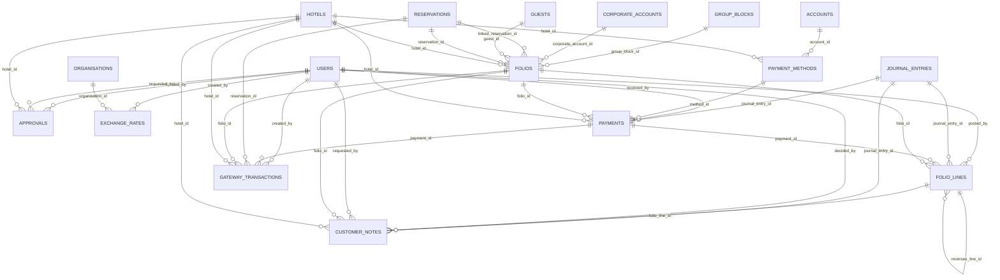

### approvals

Defined in `0001_core.sql`.

| Column | Type | Null | Default | Key / reference |
|---|---|---|---|---|
| id | INTEGER | no |  | PK |
| hotel_id | INTEGER | no |  | → hotels |
| kind | VARCHAR(40) | no |  |  |
| entity | VARCHAR(40) | no |  |  |
| entity_id | INTEGER | yes |  |  |
| payload | TEXT | no |  |  |
| amount | INTEGER | yes |  |  |
| reason | VARCHAR(300) | yes |  |  |
| status | VARCHAR(20) | no | 'pending' |  |
| requested_by | INTEGER | no |  | → users |
| decided_by | INTEGER | yes |  | → users |
| decision_note | VARCHAR(300) | yes |  |  |
| created_at | TEXT | no |  |  |
| decided_at | TEXT | yes |  |  |

### customer_notes

Defined in `0009_groups_notes_fx_recruitment.sql`. Unique: (number).

| Column | Type | Null | Default | Key / reference |
|---|---|---|---|---|
| id | INTEGER | no |  | PK |
| hotel_id | INTEGER | no |  | → hotels |
| number | VARCHAR(30) | no |  |  |
| kind | VARCHAR(6) | no |  |  |
| folio_id | INTEGER | no |  | → folios |
| department | VARCHAR(30) | no |  |  |
| description | VARCHAR(300) | no |  |  |
| reason | TEXT | no |  |  |
| net_amount | INTEGER | no |  |  |
| service_charge | INTEGER | no | 0 |  |
| tax_amount | INTEGER | no | 0 |  |
| total_amount | INTEGER | no |  |  |
| status | VARCHAR(20) | no | 'pending_approval' |  |
| requested_by | INTEGER | no |  | → users |
| decided_by | INTEGER | yes |  | → users |
| decision_note | VARCHAR(300) | yes |  |  |
| folio_line_id | INTEGER | yes |  | → folio_lines |
| journal_entry_id | INTEGER | yes |  | → journal_entries |
| created_at | TEXT | no |  |  |
| decided_at | TEXT | yes |  |  |

### exchange_rates

Defined in `0009_groups_notes_fx_recruitment.sql`. Unique: (organisation_id, currency, rate_date).

| Column | Type | Null | Default | Key / reference |
|---|---|---|---|---|
| id | INTEGER | no |  | PK |
| organisation_id | INTEGER | no |  | → organisations |
| currency | CHAR(3) | no |  |  |
| rate_date | TEXT | no |  |  |
| rate_micro | INTEGER | no |  |  |
| source | VARCHAR(100) | yes |  |  |
| created_by | INTEGER | yes |  | → users |
| created_at | TEXT | no |  |  |

### folio_lines

Defined in `0001_core.sql`.

| Column | Type | Null | Default | Key / reference |
|---|---|---|---|---|
| id | INTEGER | no |  | PK |
| folio_id | INTEGER | no |  | → folios |
| business_date | TEXT | no |  |  |
| kind | VARCHAR(12) | no |  |  |
| department | VARCHAR(30) | no |  |  |
| description | VARCHAR(300) | no |  |  |
| quantity | INTEGER | no | 1 |  |
| net_amount | INTEGER | no |  |  |
| tax_amount | INTEGER | no | 0 |  |
| service_charge | INTEGER | no | 0 |  |
| total_amount | INTEGER | no |  |  |
| reference | VARCHAR(80) | yes |  |  |
| payment_id | INTEGER | yes |  | → payments |
| journal_entry_id | INTEGER | yes |  | → journal_entries |
| reverses_line_id | INTEGER | yes |  | → folio_lines |
| posted_by | INTEGER | yes |  | → users |
| posted_at | TEXT | no |  |  |
| transfer_ref | VARCHAR(40) | yes |  |  |

### folios

Defined in `0001_core.sql`. Unique: (reservation_id), (number).

| Column | Type | Null | Default | Key / reference |
|---|---|---|---|---|
| id | INTEGER | no |  | PK |
| hotel_id | INTEGER | no |  | → hotels |
| number | VARCHAR(30) | no |  |  |
| reservation_id | INTEGER | yes |  | → reservations |
| guest_id | INTEGER | no |  | → guests |
| status | VARCHAR(10) | no | 'open' |  |
| opened_at | TEXT | no |  |  |
| closed_at | TEXT | yes |  |  |
| linked_reservation_id | INTEGER | yes |  | → reservations |
| window_name | VARCHAR(80) | yes |  |  |
| corporate_account_id | INTEGER | yes |  | → corporate_accounts |
| group_block_id | INTEGER | yes |  | → group_blocks |

### gateway_transactions

Defined in `0004_payments_finance_messaging.sql`. Unique: (reference).

| Column | Type | Null | Default | Key / reference |
|---|---|---|---|---|
| id | INTEGER | no |  | PK |
| hotel_id | INTEGER | no |  | → hotels |
| provider | VARCHAR(20) | no |  |  |
| reference | VARCHAR(80) | no |  |  |
| purpose | VARCHAR(20) | no |  |  |
| folio_id | INTEGER | yes |  | → folios |
| reservation_id | INTEGER | yes |  | → reservations |
| amount | INTEGER | no |  |  |
| currency | CHAR(3) | no |  |  |
| email | VARCHAR(200) | yes |  |  |
| status | VARCHAR(20) | no | 'initialized' |  |
| authorization_url | VARCHAR(500) | yes |  |  |
| gateway_status | VARCHAR(40) | yes |  |  |
| payment_id | INTEGER | yes |  | → payments |
| created_by | INTEGER | yes |  | → users |
| created_at | TEXT | no |  |  |
| verified_at | TEXT | yes |  |  |

### payment_methods

Defined in `0001_core.sql`. Unique: (hotel_id, code).

| Column | Type | Null | Default | Key / reference |
|---|---|---|---|---|
| id | INTEGER | no |  | PK |
| hotel_id | INTEGER | no |  | → hotels |
| code | VARCHAR(30) | no |  |  |
| name | VARCHAR(100) | no |  |  |
| kind | VARCHAR(20) | no |  |  |
| account_id | INTEGER | no |  | → accounts |
| active | INTEGER | no | 1 |  |

### payments

Defined in `0001_core.sql`. Unique: (idempotency_key).

| Column | Type | Null | Default | Key / reference |
|---|---|---|---|---|
| id | INTEGER | no |  | PK |
| hotel_id | INTEGER | no |  | → hotels |
| folio_id | INTEGER | no |  | → folios |
| method_id | INTEGER | no |  | → payment_methods |
| kind | VARCHAR(10) | no | 'payment' |  |
| amount | INTEGER | no |  |  |
| currency | CHAR(3) | no | 'NGN' |  |
| status | VARCHAR(20) | no |  |  |
| reference | VARCHAR(100) | yes |  |  |
| idempotency_key | VARCHAR(100) | yes |  |  |
| gateway | VARCHAR(30) | yes |  |  |
| gateway_reference | VARCHAR(100) | yes |  |  |
| note | VARCHAR(300) | yes |  |  |
| received_by | INTEGER | yes |  | → users |
| journal_entry_id | INTEGER | yes |  | → journal_entries |
| created_at | TEXT | no |  |  |
| foreign_currency | CHAR(3) | yes |  |  |
| foreign_amount | INTEGER | yes |  |  |
| exchange_rate_micro | INTEGER | yes |  |  |

## Accounting and finance

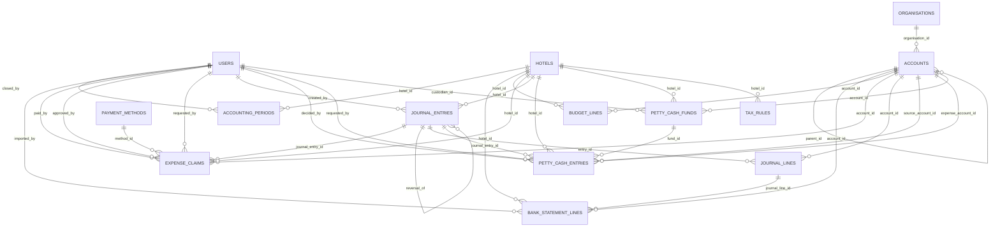

### accounting_periods

Defined in `0004_payments_finance_messaging.sql`. Unique: (hotel_id, period).

| Column | Type | Null | Default | Key / reference |
|---|---|---|---|---|
| id | INTEGER | no |  | PK |
| hotel_id | INTEGER | no |  | → hotels |
| period | CHAR(7) | no |  |  |
| status | VARCHAR(10) | no |  |  |
| closed_by | INTEGER | yes |  | → users |
| closed_at | TEXT | yes |  |  |
| note | VARCHAR(300) | yes |  |  |

### accounts

Defined in `0001_core.sql`. Unique: (organisation_id, code).

| Column | Type | Null | Default | Key / reference |
|---|---|---|---|---|
| id | INTEGER | no |  | PK |
| organisation_id | INTEGER | no |  | → organisations |
| code | VARCHAR(20) | no |  |  |
| name | VARCHAR(150) | no |  |  |
| type | VARCHAR(20) | no |  |  |
| parent_id | INTEGER | yes |  | → accounts |
| is_postable | INTEGER | no | 1 |  |
| system_key | VARCHAR(40) | yes |  |  |
| active | INTEGER | no | 1 |  |

### bank_statement_lines

Defined in `0004_payments_finance_messaging.sql`. Unique: (journal_line_id).

| Column | Type | Null | Default | Key / reference |
|---|---|---|---|---|
| id | INTEGER | no |  | PK |
| hotel_id | INTEGER | no |  | → hotels |
| account_id | INTEGER | no |  | → accounts |
| txn_date | TEXT | no |  |  |
| description | VARCHAR(300) | yes |  |  |
| reference | VARCHAR(100) | yes |  |  |
| amount | INTEGER | no |  |  |
| status | VARCHAR(10) | no | 'unmatched' |  |
| journal_line_id | INTEGER | yes |  | → journal_lines |
| imported_by | INTEGER | yes |  | → users |
| created_at | TEXT | no |  |  |

### budget_lines

Defined in `0004_payments_finance_messaging.sql`. Unique: (hotel_id, account_id, period).

| Column | Type | Null | Default | Key / reference |
|---|---|---|---|---|
| id | INTEGER | no |  | PK |
| hotel_id | INTEGER | no |  | → hotels |
| account_id | INTEGER | no |  | → accounts |
| period | CHAR(7) | no |  |  |
| amount | INTEGER | no |  |  |

### expense_claims

Defined in `0004_payments_finance_messaging.sql`. Unique: (number).

| Column | Type | Null | Default | Key / reference |
|---|---|---|---|---|
| id | INTEGER | no |  | PK |
| hotel_id | INTEGER | no |  | → hotels |
| number | VARCHAR(30) | no |  |  |
| department | VARCHAR(30) | no |  |  |
| account_id | INTEGER | no |  | → accounts |
| description | VARCHAR(300) | no |  |  |
| payee | VARCHAR(150) | yes |  |  |
| amount | INTEGER | no |  |  |
| receipt_ref | VARCHAR(100) | yes |  |  |
| status | VARCHAR(20) | no | 'submitted' |  |
| requested_by | INTEGER | no |  | → users |
| approved_by | INTEGER | yes |  | → users |
| decision_note | VARCHAR(300) | yes |  |  |
| paid_by | INTEGER | yes |  | → users |
| method_id | INTEGER | yes |  | → payment_methods |
| payment_reference | VARCHAR(100) | yes |  |  |
| journal_entry_id | INTEGER | yes |  | → journal_entries |
| expense_date | TEXT | no |  |  |
| created_at | TEXT | no |  |  |
| decided_at | TEXT | yes |  |  |
| paid_at | TEXT | yes |  |  |

### journal_entries

Defined in `0001_core.sql`. Unique: (number).

| Column | Type | Null | Default | Key / reference |
|---|---|---|---|---|
| id | INTEGER | no |  | PK |
| hotel_id | INTEGER | no |  | → hotels |
| number | VARCHAR(30) | no |  |  |
| entry_date | TEXT | no |  |  |
| description | VARCHAR(300) | no |  |  |
| source | VARCHAR(30) | no |  |  |
| source_ref | VARCHAR(80) | yes |  |  |
| reversal_of | INTEGER | yes |  | → journal_entries |
| created_by | INTEGER | yes |  | → users |
| created_at | TEXT | no |  |  |

### journal_lines

Defined in `0001_core.sql`.

| Column | Type | Null | Default | Key / reference |
|---|---|---|---|---|
| id | INTEGER | no |  | PK |
| entry_id | INTEGER | no |  | → journal_entries |
| account_id | INTEGER | no |  | → accounts |
| debit | INTEGER | no | 0 |  |
| credit | INTEGER | no | 0 |  |
| department | VARCHAR(30) | yes |  |  |
| memo | VARCHAR(300) | yes |  |  |

### petty_cash_entries

Defined in `0012_requirements_completion.sql`. Unique: (number).

| Column | Type | Null | Default | Key / reference |
|---|---|---|---|---|
| id | INTEGER | no |  | PK |
| hotel_id | INTEGER | no |  | → hotels |
| fund_id | INTEGER | no |  | → petty_cash_funds |
| number | VARCHAR(30) | no |  |  |
| kind | VARCHAR(10) | no |  |  |
| payee | VARCHAR(150) | yes |  |  |
| description | VARCHAR(300) | no |  |  |
| expense_account_id | INTEGER | yes |  | → accounts |
| source_account_id | INTEGER | yes |  | → accounts |
| department | VARCHAR(30) | yes |  |  |
| amount | INTEGER | no |  |  |
| status | VARCHAR(10) | no |  |  |
| requested_by | INTEGER | no |  | → users |
| decided_by | INTEGER | yes |  | → users |
| decision_note | VARCHAR(300) | yes |  |  |
| journal_entry_id | INTEGER | yes |  | → journal_entries |
| created_at | TEXT | no |  |  |
| decided_at | TEXT | yes |  |  |

### petty_cash_funds

Defined in `0012_requirements_completion.sql`.

| Column | Type | Null | Default | Key / reference |
|---|---|---|---|---|
| id | INTEGER | no |  | PK |
| hotel_id | INTEGER | no |  | → hotels |
| name | VARCHAR(100) | no |  |  |
| account_id | INTEGER | no |  | → accounts |
| custodian_id | INTEGER | no |  | → users |
| imprest | INTEGER | no |  |  |
| voucher_limit | INTEGER | no |  |  |
| active | INTEGER | no | 1 |  |
| created_at | TEXT | no |  |  |

### tax_rules

Defined in `0001_core.sql`.

| Column | Type | Null | Default | Key / reference |
|---|---|---|---|---|
| id | INTEGER | no |  | PK |
| hotel_id | INTEGER | no |  | → hotels |
| code | VARCHAR(30) | no |  |  |
| name | VARCHAR(100) | no |  |  |
| rate_bp | INTEGER | no |  |  |
| applies_to | VARCHAR(30) | no | 'all' |  |
| is_inclusive | INTEGER | no | 0 |  |
| effective_from | TEXT | no |  |  |
| effective_to | TEXT | yes |  |  |
| active | INTEGER | no | 1 |  |

## Restaurant, bar and kitchen

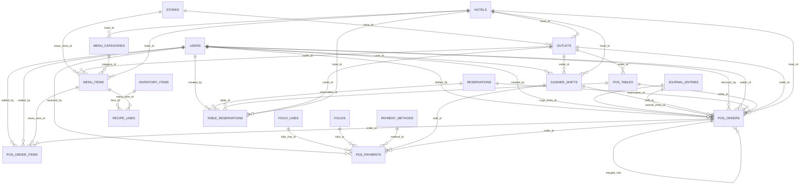

### cashier_shifts

Defined in `0003_pos_inventory_procurement.sql`. Unique: (number).

| Column | Type | Null | Default | Key / reference |
|---|---|---|---|---|
| id | INTEGER | no |  | PK |
| hotel_id | INTEGER | no |  | → hotels |
| outlet_id | INTEGER | no |  | → outlets |
| user_id | INTEGER | no |  | → users |
| number | VARCHAR(30) | no |  |  |
| status | VARCHAR(10) | no | 'open' |  |
| opening_float | INTEGER | no | 0 |  |
| expected_cash | INTEGER | yes |  |  |
| counted_cash | INTEGER | yes |  |  |
| variance | INTEGER | yes |  |  |
| note | VARCHAR(300) | yes |  |  |
| opened_at | TEXT | no |  |  |
| closed_at | TEXT | yes |  |  |

### menu_categories

Defined in `0003_pos_inventory_procurement.sql`. Unique: (hotel_id, name).

| Column | Type | Null | Default | Key / reference |
|---|---|---|---|---|
| id | INTEGER | no |  | PK |
| hotel_id | INTEGER | no |  | → hotels |
| name | VARCHAR(80) | no |  |  |
| kind | VARCHAR(20) | no | 'food' |  |
| sort_order | INTEGER | no | 0 |  |
| active | INTEGER | no | 1 |  |

### menu_items

Defined in `0003_pos_inventory_procurement.sql`. Unique: (hotel_id, code).

| Column | Type | Null | Default | Key / reference |
|---|---|---|---|---|
| id | INTEGER | no |  | PK |
| hotel_id | INTEGER | no |  | → hotels |
| category_id | INTEGER | no |  | → menu_categories |
| outlet_id | INTEGER | yes |  | → outlets |
| code | VARCHAR(30) | no |  |  |
| name | VARCHAR(120) | no |  |  |
| description | VARCHAR(300) | yes |  |  |
| price | INTEGER | no |  |  |
| station | VARCHAR(20) | no | 'kitchen' |  |
| issue_store_id | INTEGER | yes |  | → stores |
| image_url | VARCHAR(300) | yes |  |  |
| available | INTEGER | no | 1 |  |
| active | INTEGER | no | 1 |  |

### outlets

Defined in `0003_pos_inventory_procurement.sql`. Unique: (hotel_id, code).

| Column | Type | Null | Default | Key / reference |
|---|---|---|---|---|
| id | INTEGER | no |  | PK |
| hotel_id | INTEGER | no |  | → hotels |
| code | VARCHAR(30) | no |  |  |
| name | VARCHAR(100) | no |  |  |
| kind | VARCHAR(20) | no | 'restaurant' |  |
| store_id | INTEGER | yes |  | → stores |
| active | INTEGER | no | 1 |  |

### pos_order_items

Defined in `0003_pos_inventory_procurement.sql`.

| Column | Type | Null | Default | Key / reference |
|---|---|---|---|---|
| id | INTEGER | no |  | PK |
| order_id | INTEGER | no |  | → pos_orders |
| menu_item_id | INTEGER | no |  | → menu_items |
| name | VARCHAR(120) | no |  |  |
| quantity | INTEGER | no |  |  |
| unit_price | INTEGER | no |  |  |
| notes | VARCHAR(200) | yes |  |  |
| station | VARCHAR(20) | no |  |  |
| priority | INTEGER | no | 2 |  |
| kitchen_status | VARCHAR(20) | no | 'new' |  |
| sent_at | TEXT | yes |  |  |
| started_at | TEXT | yes |  |  |
| ready_at | TEXT | yes |  |  |
| served_at | TEXT | yes |  |  |
| void_reason | VARCHAR(200) | yes |  |  |
| voided_by | INTEGER | yes |  | → users |
| added_by | INTEGER | yes |  | → users |
| created_at | TEXT | no |  |  |

### pos_orders

Defined in `0003_pos_inventory_procurement.sql`. Unique: (number).

| Column | Type | Null | Default | Key / reference |
|---|---|---|---|---|
| id | INTEGER | no |  | PK |
| hotel_id | INTEGER | no |  | → hotels |
| outlet_id | INTEGER | no |  | → outlets |
| number | VARCHAR(30) | no |  |  |
| order_type | VARCHAR(20) | no |  |  |
| table_id | INTEGER | yes |  | → pos_tables |
| reservation_id | INTEGER | yes |  | → reservations |
| guest_name | VARCHAR(150) | yes |  |  |
| covers | INTEGER | no | 1 |  |
| waiter_id | INTEGER | yes |  | → users |
| status | VARCHAR(20) | no | 'open' |  |
| discount_amount | INTEGER | no | 0 |  |
| discount_reason | VARCHAR(200) | yes |  |  |
| discount_by | INTEGER | yes |  | → users |
| net_amount | INTEGER | yes |  |  |
| service_charge | INTEGER | yes |  |  |
| tax_amount | INTEGER | yes |  |  |
| total_amount | INTEGER | yes |  |  |
| merged_into | INTEGER | yes |  | → pos_orders |
| split_from | INTEGER | yes |  | → pos_orders |
| shift_id | INTEGER | yes |  | → cashier_shifts |
| journal_entry_id | INTEGER | yes |  | → journal_entries |
| cogs_entry_id | INTEGER | yes |  | → journal_entries |
| void_reason | VARCHAR(300) | yes |  |  |
| business_date | TEXT | no |  |  |
| created_by | INTEGER | no |  | → users |
| created_at | TEXT | no |  |  |
| settled_at | TEXT | yes |  |  |
| settled_by | INTEGER | yes |  | → users |

### pos_payments

Defined in `0003_pos_inventory_procurement.sql`.

| Column | Type | Null | Default | Key / reference |
|---|---|---|---|---|
| id | INTEGER | no |  | PK |
| order_id | INTEGER | no |  | → pos_orders |
| shift_id | INTEGER | yes |  | → cashier_shifts |
| tender | VARCHAR(20) | no |  |  |
| method_id | INTEGER | yes |  | → payment_methods |
| folio_id | INTEGER | yes |  | → folios |
| folio_line_id | INTEGER | yes |  | → folio_lines |
| amount | INTEGER | no |  |  |
| reference | VARCHAR(100) | yes |  |  |
| received_by | INTEGER | yes |  | → users |
| created_at | TEXT | no |  |  |

### pos_tables

Defined in `0003_pos_inventory_procurement.sql`. Unique: (outlet_id, code).

| Column | Type | Null | Default | Key / reference |
|---|---|---|---|---|
| id | INTEGER | no |  | PK |
| outlet_id | INTEGER | no |  | → outlets |
| code | VARCHAR(20) | no |  |  |
| area | VARCHAR(60) | yes |  |  |
| seats | INTEGER | no | 4 |  |
| active | INTEGER | no | 1 |  |

### recipe_lines

Defined in `0003_pos_inventory_procurement.sql`. Unique: (menu_item_id, item_id).

| Column | Type | Null | Default | Key / reference |
|---|---|---|---|---|
| id | INTEGER | no |  | PK |
| menu_item_id | INTEGER | no |  | → menu_items |
| item_id | INTEGER | no |  | → inventory_items |
| quantity_milli | INTEGER | no |  |  |

### table_reservations

Defined in `0012_requirements_completion.sql`.

| Column | Type | Null | Default | Key / reference |
|---|---|---|---|---|
| id | INTEGER | no |  | PK |
| hotel_id | INTEGER | no |  | → hotels |
| outlet_id | INTEGER | no |  | → outlets |
| table_id | INTEGER | yes |  | → pos_tables |
| guest_name | VARCHAR(150) | no |  |  |
| phone | VARCHAR(50) | yes |  |  |
| party_size | INTEGER | no |  |  |
| reserved_date | TEXT | no |  |  |
| reserved_time | VARCHAR(5) | no |  |  |
| duration_min | INTEGER | no | 90 |  |
| reservation_id | INTEGER | yes |  | → reservations |
| status | VARCHAR(10) | no | 'booked' |  |
| notes | VARCHAR(300) | yes |  |  |
| created_by | INTEGER | no |  | → users |
| created_at | TEXT | no |  |  |

## Inventory and procurement

```mermaid
erDiagram
    INVENTORY_ITEMS ||--o{ GOODS_RECEIPT_LINES : "item_id"
    PURCHASE_ORDER_LINES ||--o{ GOODS_RECEIPT_LINES : "po_line_id"
    GOODS_RECEIPTS ||--o{ GOODS_RECEIPT_LINES : "grn_id"
    USERS ||--o{ GOODS_RECEIPTS : "received_by"
    JOURNAL_ENTRIES ||--o{ GOODS_RECEIPTS : "journal_entry_id"
    STORES ||--o{ GOODS_RECEIPTS : "store_id"
    SUPPLIERS ||--o{ GOODS_RECEIPTS : "supplier_id"
    PURCHASE_ORDERS ||--o{ GOODS_RECEIPTS : "po_id"
    HOTELS ||--o{ GOODS_RECEIPTS : "hotel_id"
    HOTELS ||--o{ INVENTORY_ITEMS : "hotel_id"
    INVENTORY_ITEMS ||--o{ PURCHASE_ORDER_LINES : "item_id"
    PURCHASE_ORDERS ||--o{ PURCHASE_ORDER_LINES : "po_id"
    USERS ||--o{ PURCHASE_ORDERS : "approved_by"
    USERS ||--o{ PURCHASE_ORDERS : "created_by"
    STORES ||--o{ PURCHASE_ORDERS : "store_id"
    SUPPLIER_QUOTES ||--o{ PURCHASE_ORDERS : "quote_id"
    PURCHASE_REQUISITIONS ||--o{ PURCHASE_ORDERS : "requisition_id"
    SUPPLIERS ||--o{ PURCHASE_ORDERS : "supplier_id"
    HOTELS ||--o{ PURCHASE_ORDERS : "hotel_id"
    INVENTORY_ITEMS ||--o{ PURCHASE_REQUISITION_LINES : "item_id"
    PURCHASE_REQUISITIONS ||--o{ PURCHASE_REQUISITION_LINES : "requisition_id"
    USERS ||--o{ PURCHASE_REQUISITIONS : "approved_by"
    USERS ||--o{ PURCHASE_REQUISITIONS : "requested_by"
    STORES ||--o{ PURCHASE_REQUISITIONS : "store_id"
    HOTELS ||--o{ PURCHASE_REQUISITIONS : "hotel_id"
    INVENTORY_ITEMS ||--o{ PURCHASE_RETURN_LINES : "item_id"
    GOODS_RECEIPT_LINES ||--o{ PURCHASE_RETURN_LINES : "grn_line_id"
    PURCHASE_RETURNS ||--o{ PURCHASE_RETURN_LINES : "return_id"
    USERS ||--o{ PURCHASE_RETURNS : "created_by"
    JOURNAL_ENTRIES ||--o{ PURCHASE_RETURNS : "journal_entry_id"
    SUPPLIER_INVOICES ||--o{ PURCHASE_RETURNS : "invoice_id"
    SUPPLIERS ||--o{ PURCHASE_RETURNS : "supplier_id"
    PURCHASE_ORDERS ||--o{ PURCHASE_RETURNS : "po_id"
    GOODS_RECEIPTS ||--o{ PURCHASE_RETURNS : "grn_id"
    HOTELS ||--o{ PURCHASE_RETURNS : "hotel_id"
    STORES ||--o{ STOCK_BATCHES : "store_id"
    INVENTORY_ITEMS ||--o{ STOCK_BATCHES : "item_id"
    INVENTORY_ITEMS ||--o{ STOCK_COUNT_LINES : "item_id"
    STOCK_COUNTS ||--o{ STOCK_COUNT_LINES : "count_id"
    USERS ||--o{ STOCK_COUNTS : "posted_by"
    USERS ||--o{ STOCK_COUNTS : "created_by"
    STORES ||--o{ STOCK_COUNTS : "store_id"
    HOTELS ||--o{ STOCK_COUNTS : "hotel_id"
    STORES ||--o{ STOCK_LEVELS : "store_id"
    INVENTORY_ITEMS ||--o{ STOCK_LEVELS : "item_id"
    USERS ||--o{ STOCK_MOVEMENTS : "created_by"
    JOURNAL_ENTRIES ||--o{ STOCK_MOVEMENTS : "journal_entry_id"
    STORES ||--o{ STOCK_MOVEMENTS : "store_id"
    INVENTORY_ITEMS ||--o{ STOCK_MOVEMENTS : "item_id"
    HOTELS ||--o{ STOCK_MOVEMENTS : "hotel_id"
    INVENTORY_ITEMS ||--o{ STOCK_REQUISITION_LINES : "item_id"
    STOCK_REQUISITIONS ||--o{ STOCK_REQUISITION_LINES : "requisition_id"
    USERS ||--o{ STOCK_REQUISITIONS : "issued_by"
    USERS ||--o{ STOCK_REQUISITIONS : "approved_by"
    USERS ||--o{ STOCK_REQUISITIONS : "requested_by"
    STORES ||--o{ STOCK_REQUISITIONS : "to_store_id"
    STORES ||--o{ STOCK_REQUISITIONS : "from_store_id"
    HOTELS ||--o{ STOCK_REQUISITIONS : "hotel_id"
    HOTELS ||--o{ STORES : "hotel_id"
    USERS ||--o{ SUPPLIER_INVOICES : "approved_by"
    USERS ||--o{ SUPPLIER_INVOICES : "created_by"
    JOURNAL_ENTRIES ||--o{ SUPPLIER_INVOICES : "journal_entry_id"
    PURCHASE_ORDERS ||--o{ SUPPLIER_INVOICES : "po_id"
    SUPPLIERS ||--o{ SUPPLIER_INVOICES : "supplier_id"
    HOTELS ||--o{ SUPPLIER_INVOICES : "hotel_id"
    USERS ||--o{ SUPPLIER_PAYMENTS : "paid_by"
    JOURNAL_ENTRIES ||--o{ SUPPLIER_PAYMENTS : "journal_entry_id"
    PAYMENT_METHODS ||--o{ SUPPLIER_PAYMENTS : "method_id"
    SUPPLIER_INVOICES ||--o{ SUPPLIER_PAYMENTS : "invoice_id"
    SUPPLIERS ||--o{ SUPPLIER_PAYMENTS : "supplier_id"
    HOTELS ||--o{ SUPPLIER_PAYMENTS : "hotel_id"
    PURCHASE_REQUISITION_LINES ||--o{ SUPPLIER_QUOTE_LINES : "requisition_line_id"
    SUPPLIER_QUOTES ||--o{ SUPPLIER_QUOTE_LINES : "quote_id"
    USERS ||--o{ SUPPLIER_QUOTES : "created_by"
    SUPPLIERS ||--o{ SUPPLIER_QUOTES : "supplier_id"
    PURCHASE_REQUISITIONS ||--o{ SUPPLIER_QUOTES : "requisition_id"
    HOTELS ||--o{ SUPPLIER_QUOTES : "hotel_id"
    ORGANISATIONS ||--o{ SUPPLIERS : "organisation_id"
```

### goods_receipt_lines

Defined in `0003_pos_inventory_procurement.sql`.

| Column | Type | Null | Default | Key / reference |
|---|---|---|---|---|
| id | INTEGER | no |  | PK |
| grn_id | INTEGER | no |  | → goods_receipts |
| po_line_id | INTEGER | no |  | → purchase_order_lines |
| item_id | INTEGER | yes |  | → inventory_items |
| received_milli | INTEGER | no |  |  |
| rejected_milli | INTEGER | no | 0 |  |
| unit_cost | INTEGER | no |  |  |
| value | INTEGER | no |  |  |
| batch_no | VARCHAR(60) | yes |  |  |
| expiry_date | TEXT | yes |  |  |

### goods_receipts

Defined in `0003_pos_inventory_procurement.sql`. Unique: (number).

| Column | Type | Null | Default | Key / reference |
|---|---|---|---|---|
| id | INTEGER | no |  | PK |
| hotel_id | INTEGER | no |  | → hotels |
| number | VARCHAR(30) | no |  |  |
| po_id | INTEGER | no |  | → purchase_orders |
| supplier_id | INTEGER | no |  | → suppliers |
| store_id | INTEGER | no |  | → stores |
| delivery_note | VARCHAR(60) | yes |  |  |
| value | INTEGER | no |  |  |
| note | VARCHAR(300) | yes |  |  |
| journal_entry_id | INTEGER | yes |  | → journal_entries |
| received_by | INTEGER | no |  | → users |
| received_at | TEXT | no |  |  |
| business_date | TEXT | no |  |  |

### inventory_items

Defined in `0003_pos_inventory_procurement.sql`. Unique: (hotel_id, code).

| Column | Type | Null | Default | Key / reference |
|---|---|---|---|---|
| id | INTEGER | no |  | PK |
| hotel_id | INTEGER | no |  | → hotels |
| code | VARCHAR(40) | no |  |  |
| barcode | VARCHAR(60) | yes |  |  |
| name | VARCHAR(150) | no |  |  |
| category | VARCHAR(30) | no |  |  |
| unit | VARCHAR(20) | no |  |  |
| last_cost | INTEGER | no | 0 |  |
| sale_price | INTEGER | yes |  |  |
| reorder_level_milli | INTEGER | no | 0 |  |
| reorder_qty_milli | INTEGER | no | 0 |  |
| track_expiry | INTEGER | no | 0 |  |
| active | INTEGER | no | 1 |  |
| created_at | TEXT | no |  |  |

### purchase_order_lines

Defined in `0003_pos_inventory_procurement.sql`.

| Column | Type | Null | Default | Key / reference |
|---|---|---|---|---|
| id | INTEGER | no |  | PK |
| po_id | INTEGER | no |  | → purchase_orders |
| item_id | INTEGER | yes |  | → inventory_items |
| description | VARCHAR(200) | no |  |  |
| expense_key | VARCHAR(40) | yes |  |  |
| quantity_milli | INTEGER | no |  |  |
| unit_cost | INTEGER | no |  |  |
| received_milli | INTEGER | no | 0 |  |

### purchase_orders

Defined in `0003_pos_inventory_procurement.sql`. Unique: (number).

| Column | Type | Null | Default | Key / reference |
|---|---|---|---|---|
| id | INTEGER | no |  | PK |
| hotel_id | INTEGER | no |  | → hotels |
| number | VARCHAR(30) | no |  |  |
| supplier_id | INTEGER | no |  | → suppliers |
| requisition_id | INTEGER | yes |  | → purchase_requisitions |
| quote_id | INTEGER | yes |  | → supplier_quotes |
| store_id | INTEGER | no |  | → stores |
| status | VARCHAR(20) | no | 'pending_approval' |  |
| order_date | TEXT | no |  |  |
| expected_date | TEXT | yes |  |  |
| total | INTEGER | no | 0 |  |
| approval_level | VARCHAR(10) | no | 'standard' |  |
| note | VARCHAR(500) | yes |  |  |
| created_by | INTEGER | no |  | → users |
| approved_by | INTEGER | yes |  | → users |
| decision_note | VARCHAR(300) | yes |  |  |
| created_at | TEXT | no |  |  |
| approved_at | TEXT | yes |  |  |

### purchase_requisition_lines

Defined in `0003_pos_inventory_procurement.sql`.

| Column | Type | Null | Default | Key / reference |
|---|---|---|---|---|
| id | INTEGER | no |  | PK |
| requisition_id | INTEGER | no |  | → purchase_requisitions |
| item_id | INTEGER | yes |  | → inventory_items |
| description | VARCHAR(200) | no |  |  |
| quantity_milli | INTEGER | no |  |  |
| est_unit_cost | INTEGER | no | 0 |  |

### purchase_requisitions

Defined in `0003_pos_inventory_procurement.sql`. Unique: (number).

| Column | Type | Null | Default | Key / reference |
|---|---|---|---|---|
| id | INTEGER | no |  | PK |
| hotel_id | INTEGER | no |  | → hotels |
| number | VARCHAR(30) | no |  |  |
| department | VARCHAR(30) | no |  |  |
| store_id | INTEGER | yes |  | → stores |
| status | VARCHAR(20) | no | 'submitted' |  |
| needed_by | TEXT | yes |  |  |
| justification | VARCHAR(500) | yes |  |  |
| estimated_total | INTEGER | no | 0 |  |
| requested_by | INTEGER | no |  | → users |
| approved_by | INTEGER | yes |  | → users |
| decision_note | VARCHAR(300) | yes |  |  |
| created_at | TEXT | no |  |  |
| decided_at | TEXT | yes |  |  |

### purchase_return_lines

Defined in `0012_requirements_completion.sql`.

| Column | Type | Null | Default | Key / reference |
|---|---|---|---|---|
| id | INTEGER | no |  | PK |
| return_id | INTEGER | no |  | → purchase_returns |
| grn_line_id | INTEGER | no |  | → goods_receipt_lines |
| item_id | INTEGER | yes |  | → inventory_items |
| quantity_milli | INTEGER | no |  |  |
| unit_cost | INTEGER | no |  |  |
| value | INTEGER | no |  |  |

### purchase_returns

Defined in `0012_requirements_completion.sql`. Unique: (number).

| Column | Type | Null | Default | Key / reference |
|---|---|---|---|---|
| id | INTEGER | no |  | PK |
| hotel_id | INTEGER | no |  | → hotels |
| number | VARCHAR(30) | no |  |  |
| grn_id | INTEGER | no |  | → goods_receipts |
| po_id | INTEGER | no |  | → purchase_orders |
| supplier_id | INTEGER | no |  | → suppliers |
| invoice_id | INTEGER | yes |  | → supplier_invoices |
| settlement | VARCHAR(15) | no |  |  |
| value | INTEGER | no |  |  |
| reason | VARCHAR(300) | no |  |  |
| journal_entry_id | INTEGER | yes |  | → journal_entries |
| created_by | INTEGER | no |  | → users |
| created_at | TEXT | no |  |  |

### stock_batches

Defined in `0003_pos_inventory_procurement.sql`.

| Column | Type | Null | Default | Key / reference |
|---|---|---|---|---|
| id | INTEGER | no |  | PK |
| item_id | INTEGER | no |  | → inventory_items |
| store_id | INTEGER | no |  | → stores |
| batch_no | VARCHAR(60) | yes |  |  |
| expiry_date | TEXT | yes |  |  |
| quantity_milli | INTEGER | no |  |  |
| received_at | TEXT | no |  |  |
| unit_cost | INTEGER | yes |  |  |

### stock_count_lines

Defined in `0003_pos_inventory_procurement.sql`. Unique: (count_id, item_id).

| Column | Type | Null | Default | Key / reference |
|---|---|---|---|---|
| id | INTEGER | no |  | PK |
| count_id | INTEGER | no |  | → stock_counts |
| item_id | INTEGER | no |  | → inventory_items |
| system_milli | INTEGER | no |  |  |
| counted_milli | INTEGER | yes |  |  |

### stock_counts

Defined in `0003_pos_inventory_procurement.sql`. Unique: (number).

| Column | Type | Null | Default | Key / reference |
|---|---|---|---|---|
| id | INTEGER | no |  | PK |
| hotel_id | INTEGER | no |  | → hotels |
| number | VARCHAR(30) | no |  |  |
| store_id | INTEGER | no |  | → stores |
| status | VARCHAR(20) | no | 'draft' |  |
| note | VARCHAR(300) | yes |  |  |
| created_by | INTEGER | no |  | → users |
| posted_by | INTEGER | yes |  | → users |
| created_at | TEXT | no |  |  |
| posted_at | TEXT | yes |  |  |

### stock_levels

Defined in `0003_pos_inventory_procurement.sql`. Unique: (item_id, store_id).

| Column | Type | Null | Default | Key / reference |
|---|---|---|---|---|
| id | INTEGER | no |  | PK |
| item_id | INTEGER | no |  | → inventory_items |
| store_id | INTEGER | no |  | → stores |
| quantity_milli | INTEGER | no | 0 |  |
| value | INTEGER | no | 0 |  |

### stock_movements

Defined in `0003_pos_inventory_procurement.sql`.

| Column | Type | Null | Default | Key / reference |
|---|---|---|---|---|
| id | INTEGER | no |  | PK |
| hotel_id | INTEGER | no |  | → hotels |
| item_id | INTEGER | no |  | → inventory_items |
| store_id | INTEGER | no |  | → stores |
| movement_type | VARCHAR(20) | no |  |  |
| quantity_milli | INTEGER | no |  |  |
| value | INTEGER | no |  |  |
| balance_milli | INTEGER | no |  |  |
| balance_value | INTEGER | no |  |  |
| source | VARCHAR(30) | no |  |  |
| source_ref | VARCHAR(60) | yes |  |  |
| department | VARCHAR(30) | yes |  |  |
| reason | VARCHAR(300) | yes |  |  |
| batch_no | VARCHAR(60) | yes |  |  |
| expiry_date | TEXT | yes |  |  |
| journal_entry_id | INTEGER | yes |  | → journal_entries |
| business_date | TEXT | no |  |  |
| created_by | INTEGER | yes |  | → users |
| created_at | TEXT | no |  |  |

### stock_requisition_lines

Defined in `0003_pos_inventory_procurement.sql`.

| Column | Type | Null | Default | Key / reference |
|---|---|---|---|---|
| id | INTEGER | no |  | PK |
| requisition_id | INTEGER | no |  | → stock_requisitions |
| item_id | INTEGER | no |  | → inventory_items |
| requested_milli | INTEGER | no |  |  |
| issued_milli | INTEGER | no | 0 |  |

### stock_requisitions

Defined in `0003_pos_inventory_procurement.sql`. Unique: (number).

| Column | Type | Null | Default | Key / reference |
|---|---|---|---|---|
| id | INTEGER | no |  | PK |
| hotel_id | INTEGER | no |  | → hotels |
| number | VARCHAR(30) | no |  |  |
| from_store_id | INTEGER | no |  | → stores |
| to_store_id | INTEGER | yes |  | → stores |
| department | VARCHAR(30) | yes |  |  |
| status | VARCHAR(20) | no | 'pending' |  |
| note | VARCHAR(300) | yes |  |  |
| requested_by | INTEGER | no |  | → users |
| approved_by | INTEGER | yes |  | → users |
| issued_by | INTEGER | yes |  | → users |
| decision_note | VARCHAR(300) | yes |  |  |
| created_at | TEXT | no |  |  |
| approved_at | TEXT | yes |  |  |
| issued_at | TEXT | yes |  |  |

### stores

Defined in `0003_pos_inventory_procurement.sql`. Unique: (hotel_id, code).

| Column | Type | Null | Default | Key / reference |
|---|---|---|---|---|
| id | INTEGER | no |  | PK |
| hotel_id | INTEGER | no |  | → hotels |
| code | VARCHAR(30) | no |  |  |
| name | VARCHAR(100) | no |  |  |
| kind | VARCHAR(20) | no | 'main' |  |
| allow_negative | INTEGER | no | 0 |  |
| active | INTEGER | no | 1 |  |

### supplier_invoices

Defined in `0003_pos_inventory_procurement.sql`. Unique: (supplier_id, invoice_no), (number).

| Column | Type | Null | Default | Key / reference |
|---|---|---|---|---|
| id | INTEGER | no |  | PK |
| hotel_id | INTEGER | no |  | → hotels |
| number | VARCHAR(30) | no |  |  |
| supplier_id | INTEGER | no |  | → suppliers |
| po_id | INTEGER | yes |  | → purchase_orders |
| invoice_no | VARCHAR(60) | no |  |  |
| invoice_date | TEXT | no |  |  |
| due_date | TEXT | no |  |  |
| amount | INTEGER | no |  |  |
| received_value | INTEGER | no | 0 |  |
| variance | INTEGER | no | 0 |  |
| match_status | VARCHAR(20) | no |  |  |
| expense_key | VARCHAR(40) | yes |  |  |
| status | VARCHAR(20) | no | 'pending_approval' |  |
| amount_paid | INTEGER | no | 0 |  |
| note | VARCHAR(300) | yes |  |  |
| journal_entry_id | INTEGER | yes |  | → journal_entries |
| created_by | INTEGER | no |  | → users |
| approved_by | INTEGER | yes |  | → users |
| decision_note | VARCHAR(300) | yes |  |  |
| created_at | TEXT | no |  |  |
| approved_at | TEXT | yes |  |  |

### supplier_payments

Defined in `0003_pos_inventory_procurement.sql`. Unique: (idempotency_key), (number).

| Column | Type | Null | Default | Key / reference |
|---|---|---|---|---|
| id | INTEGER | no |  | PK |
| hotel_id | INTEGER | no |  | → hotels |
| number | VARCHAR(30) | no |  |  |
| supplier_id | INTEGER | no |  | → suppliers |
| invoice_id | INTEGER | no |  | → supplier_invoices |
| method_id | INTEGER | no |  | → payment_methods |
| gross_amount | INTEGER | no |  |  |
| wht_amount | INTEGER | no | 0 |  |
| net_amount | INTEGER | no |  |  |
| reference | VARCHAR(100) | yes |  |  |
| idempotency_key | VARCHAR(100) | yes |  |  |
| journal_entry_id | INTEGER | yes |  | → journal_entries |
| paid_by | INTEGER | no |  | → users |
| created_at | TEXT | no |  |  |

### supplier_quote_lines

Defined in `0003_pos_inventory_procurement.sql`.

| Column | Type | Null | Default | Key / reference |
|---|---|---|---|---|
| id | INTEGER | no |  | PK |
| quote_id | INTEGER | no |  | → supplier_quotes |
| requisition_line_id | INTEGER | no |  | → purchase_requisition_lines |
| unit_cost | INTEGER | no |  |  |

### supplier_quotes

Defined in `0003_pos_inventory_procurement.sql`.

| Column | Type | Null | Default | Key / reference |
|---|---|---|---|---|
| id | INTEGER | no |  | PK |
| hotel_id | INTEGER | no |  | → hotels |
| requisition_id | INTEGER | no |  | → purchase_requisitions |
| supplier_id | INTEGER | no |  | → suppliers |
| reference | VARCHAR(60) | yes |  |  |
| valid_until | TEXT | yes |  |  |
| delivery_days | INTEGER | yes |  |  |
| total | INTEGER | no |  |  |
| status | VARCHAR(20) | no | 'received' |  |
| note | VARCHAR(300) | yes |  |  |
| created_by | INTEGER | no |  | → users |
| created_at | TEXT | no |  |  |

### suppliers

Defined in `0003_pos_inventory_procurement.sql`. Unique: (organisation_id, code).

| Column | Type | Null | Default | Key / reference |
|---|---|---|---|---|
| id | INTEGER | no |  | PK |
| organisation_id | INTEGER | no |  | → organisations |
| code | VARCHAR(30) | no |  |  |
| name | VARCHAR(200) | no |  |  |
| category | VARCHAR(60) | yes |  |  |
| contact_name | VARCHAR(150) | yes |  |  |
| phone | VARCHAR(50) | yes |  |  |
| email | VARCHAR(200) | yes |  |  |
| address | TEXT | yes |  |  |
| tax_id | VARCHAR(50) | yes |  |  |
| bank_name | VARCHAR(100) | yes |  |  |
| bank_account_name | VARCHAR(150) | yes |  |  |
| bank_account_number | VARCHAR(30) | yes |  |  |
| payment_terms_days | INTEGER | no | 30 |  |
| wht_bp | INTEGER | no | 0 |  |
| active | INTEGER | no | 1 |  |
| created_at | TEXT | no |  |  |

## Housekeeping and laundry

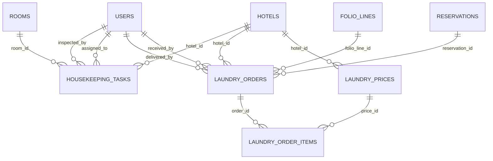

### housekeeping_tasks

Defined in `0001_core.sql`.

| Column | Type | Null | Default | Key / reference |
|---|---|---|---|---|
| id | INTEGER | no |  | PK |
| hotel_id | INTEGER | no |  | → hotels |
| room_id | INTEGER | no |  | → rooms |
| task_type | VARCHAR(20) | no |  |  |
| status | VARCHAR(20) | no | 'pending' |  |
| priority | INTEGER | no | 2 |  |
| assigned_to | INTEGER | yes |  | → users |
| notes | TEXT | yes |  |  |
| issues | TEXT | yes |  |  |
| business_date | TEXT | no |  |  |
| created_at | TEXT | no |  |  |
| started_at | TEXT | yes |  |  |
| completed_at | TEXT | yes |  |  |
| inspected_by | INTEGER | yes |  | → users |
| inspected_at | TEXT | yes |  |  |

### laundry_order_items

Defined in `0005_laundry_hr_payroll.sql`.

| Column | Type | Null | Default | Key / reference |
|---|---|---|---|---|
| id | INTEGER | no |  | PK |
| order_id | INTEGER | no |  | → laundry_orders |
| price_id | INTEGER | yes |  | → laundry_prices |
| description | VARCHAR(120) | no |  |  |
| service | VARCHAR(20) | no |  |  |
| quantity | INTEGER | no |  |  |
| unit_price | INTEGER | no | 0 |  |
| condition_note | VARCHAR(200) | yes |  |  |
| outcome | VARCHAR(10) | no | 'ok' |  |
| outcome_note | VARCHAR(200) | yes |  |  |

### laundry_orders

Defined in `0005_laundry_hr_payroll.sql`. Unique: (number).

| Column | Type | Null | Default | Key / reference |
|---|---|---|---|---|
| id | INTEGER | no |  | PK |
| hotel_id | INTEGER | no |  | → hotels |
| number | VARCHAR(30) | no |  |  |
| kind | VARCHAR(10) | no |  |  |
| reservation_id | INTEGER | yes |  | → reservations |
| department | VARCHAR(30) | yes |  |  |
| status | VARCHAR(20) | no | 'received' |  |
| express | INTEGER | no | 0 |  |
| total | INTEGER | no | 0 |  |
| notes | VARCHAR(300) | yes |  |  |
| due_at | TEXT | yes |  |  |
| folio_line_id | INTEGER | yes |  | → folio_lines |
| received_by | INTEGER | no |  | → users |
| delivered_by | INTEGER | yes |  | → users |
| created_at | TEXT | no |  |  |
| delivered_at | TEXT | yes |  |  |
| business_date | TEXT | no |  |  |

### laundry_prices

Defined in `0005_laundry_hr_payroll.sql`. Unique: (hotel_id, item, service).

| Column | Type | Null | Default | Key / reference |
|---|---|---|---|---|
| id | INTEGER | no |  | PK |
| hotel_id | INTEGER | no |  | → hotels |
| item | VARCHAR(80) | no |  |  |
| service | VARCHAR(20) | no |  |  |
| price | INTEGER | no |  |  |
| active | INTEGER | no | 1 |  |

## Human resources and payroll

```mermaid
erDiagram
    USERS ||--o{ APPLICANT_EVENTS : "created_by"
    APPLICANTS ||--o{ APPLICANT_EVENTS : "applicant_id"
    USERS ||--o{ APPLICANTS : "created_by"
    EMPLOYEES ||--o{ APPLICANTS : "employee_id"
    JOB_OPENINGS ||--o{ APPLICANTS : "opening_id"
    USERS ||--o{ APPRAISALS : "reviewer_id"
    EMPLOYEES ||--o{ APPRAISALS : "employee_id"
    USERS ||--o{ ATTENDANCE : "recorded_by"
    EMPLOYEES ||--o{ ATTENDANCE : "employee_id"
    USERS ||--o{ EMPLOYEE_HISTORY : "created_by"
    EMPLOYEES ||--o{ EMPLOYEE_HISTORY : "employee_id"
    USERS ||--o{ EMPLOYEE_LOANS : "created_by"
    JOURNAL_ENTRIES ||--o{ EMPLOYEE_LOANS : "journal_entry_id"
    EMPLOYEES ||--o{ EMPLOYEE_LOANS : "employee_id"
    EMPLOYEES ||--o{ EMPLOYEES : "line_manager_id"
    USERS ||--o{ EMPLOYEES : "user_id"
    HOTELS ||--o{ EMPLOYEES : "hotel_id"
    USERS ||--o{ HR_RECORDS : "created_by"
    EMPLOYEES ||--o{ HR_RECORDS : "employee_id"
    USERS ||--o{ JOB_OPENINGS : "created_by"
    HOTELS ||--o{ JOB_OPENINGS : "hotel_id"
    USERS ||--o{ LEAVE_ADJUSTMENTS : "created_by"
    LEAVE_TYPES ||--o{ LEAVE_ADJUSTMENTS : "leave_type_id"
    EMPLOYEES ||--o{ LEAVE_ADJUSTMENTS : "employee_id"
    USERS ||--o{ LEAVE_REQUESTS : "decided_by"
    USERS ||--o{ LEAVE_REQUESTS : "requested_by"
    LEAVE_TYPES ||--o{ LEAVE_REQUESTS : "leave_type_id"
    EMPLOYEES ||--o{ LEAVE_REQUESTS : "employee_id"
    HOTELS ||--o{ LEAVE_TYPES : "hotel_id"
    USERS ||--o{ PAYROLL_ADJUSTMENTS : "created_by"
    EMPLOYEES ||--o{ PAYROLL_ADJUSTMENTS : "employee_id"
    PAYROLL_RUNS ||--o{ PAYROLL_ADJUSTMENTS : "run_id"
    JOURNAL_ENTRIES ||--o{ PAYROLL_RUNS : "payment_journal_id"
    JOURNAL_ENTRIES ||--o{ PAYROLL_RUNS : "journal_entry_id"
    USERS ||--o{ PAYROLL_RUNS : "paid_by"
    USERS ||--o{ PAYROLL_RUNS : "approved_by"
    USERS ||--o{ PAYROLL_RUNS : "created_by"
    HOTELS ||--o{ PAYROLL_RUNS : "hotel_id"
    EMPLOYEES ||--o{ PAYSLIPS : "employee_id"
    PAYROLL_RUNS ||--o{ PAYSLIPS : "run_id"
    HOTELS ||--o{ PUBLIC_HOLIDAYS : "hotel_id"
    SHIFT_TEMPLATES ||--o{ SHIFT_ASSIGNMENTS : "shift_id"
    EMPLOYEES ||--o{ SHIFT_ASSIGNMENTS : "employee_id"
    HOTELS ||--o{ SHIFT_TEMPLATES : "hotel_id"
    USERS ||--o{ STAFF_REQUESTS : "created_by"
    USERS ||--o{ STAFF_REQUESTS : "decided_by"
    EMPLOYEES ||--o{ STAFF_REQUESTS : "employee_id"
    USERS ||--o{ TRAININGS : "created_by"
    EMPLOYEES ||--o{ TRAININGS : "employee_id"
    USERS ||--o{ WELFARE_RECORDS : "created_by"
    EMPLOYEES ||--o{ WELFARE_RECORDS : "employee_id"
```

### applicant_events

Defined in `0009_groups_notes_fx_recruitment.sql`.

| Column | Type | Null | Default | Key / reference |
|---|---|---|---|---|
| id | INTEGER | no |  | PK |
| applicant_id | INTEGER | no |  | → applicants |
| kind | VARCHAR(12) | no |  |  |
| from_stage | VARCHAR(12) | yes |  |  |
| to_stage | VARCHAR(12) | yes |  |  |
| note | TEXT | yes |  |  |
| interview_at | TEXT | yes |  |  |
| score | INTEGER | yes |  |  |
| created_by | INTEGER | yes |  | → users |
| created_at | TEXT | no |  |  |

### applicants

Defined in `0009_groups_notes_fx_recruitment.sql`.

| Column | Type | Null | Default | Key / reference |
|---|---|---|---|---|
| id | INTEGER | no |  | PK |
| opening_id | INTEGER | no |  | → job_openings |
| first_name | VARCHAR(100) | no |  |  |
| last_name | VARCHAR(100) | no |  |  |
| email | VARCHAR(200) | yes |  |  |
| phone | VARCHAR(50) | yes |  |  |
| source | VARCHAR(40) | yes |  |  |
| stage | VARCHAR(12) | no | 'applied' |  |
| rating | INTEGER | yes |  |  |
| expected_salary | INTEGER | yes |  |  |
| offered_salary | INTEGER | yes |  |  |
| start_date | TEXT | yes |  |  |
| employee_id | INTEGER | yes |  | → employees |
| consent_to_retain | INTEGER | no | 0 |  |
| created_by | INTEGER | yes |  | → users |
| created_at | TEXT | no |  |  |
| updated_at | TEXT | no |  |  |

### appraisals

Defined in `0011_hr_suite.sql`.

| Column | Type | Null | Default | Key / reference |
|---|---|---|---|---|
| id | INTEGER | no |  | PK |
| employee_id | INTEGER | no |  | → employees |
| period | VARCHAR(30) | no |  |  |
| reviewer_id | INTEGER | no |  | → users |
| status | VARCHAR(15) | no | 'draft' |  |
| criteria | TEXT | no |  |  |
| overall_rating | INTEGER | yes |  |  |
| strengths | TEXT | yes |  |  |
| improvements | TEXT | yes |  |  |
| goals | TEXT | yes |  |  |
| employee_comment | TEXT | yes |  |  |
| created_at | TEXT | no |  |  |
| shared_at | TEXT | yes |  |  |
| acknowledged_at | TEXT | yes |  |  |

### attendance

Defined in `0005_laundry_hr_payroll.sql`. Unique: (employee_id, work_date).

| Column | Type | Null | Default | Key / reference |
|---|---|---|---|---|
| id | INTEGER | no |  | PK |
| employee_id | INTEGER | no |  | → employees |
| work_date | TEXT | no |  |  |
| status | VARCHAR(10) | no |  |  |
| clock_in | VARCHAR(5) | yes |  |  |
| clock_out | VARCHAR(5) | yes |  |  |
| overtime_minutes | INTEGER | no | 0 |  |
| note | VARCHAR(200) | yes |  |  |
| recorded_by | INTEGER | yes |  | → users |
| recorded_at | TEXT | no |  |  |

### employee_history

Defined in `0011_hr_suite.sql`.

| Column | Type | Null | Default | Key / reference |
|---|---|---|---|---|
| id | INTEGER | no |  | PK |
| employee_id | INTEGER | no |  | → employees |
| kind | VARCHAR(20) | no |  |  |
| effective_date | TEXT | no |  |  |
| from_value | VARCHAR(200) | yes |  |  |
| to_value | VARCHAR(200) | yes |  |  |
| note | VARCHAR(300) | yes |  |  |
| created_by | INTEGER | no |  | → users |
| created_at | TEXT | no |  |  |

### employee_loans

Defined in `0005_laundry_hr_payroll.sql`.

| Column | Type | Null | Default | Key / reference |
|---|---|---|---|---|
| id | INTEGER | no |  | PK |
| employee_id | INTEGER | no |  | → employees |
| description | VARCHAR(200) | no |  |  |
| principal | INTEGER | no |  |  |
| monthly_deduction | INTEGER | no |  |  |
| balance | INTEGER | no |  |  |
| status | VARCHAR(10) | no | 'active' |  |
| journal_entry_id | INTEGER | yes |  | → journal_entries |
| created_by | INTEGER | no |  | → users |
| created_at | TEXT | no |  |  |

### employees

Defined in `0005_laundry_hr_payroll.sql`. Unique: (user_id), (employee_no).

| Column | Type | Null | Default | Key / reference |
|---|---|---|---|---|
| id | INTEGER | no |  | PK |
| hotel_id | INTEGER | no |  | → hotels |
| employee_no | VARCHAR(30) | no |  |  |
| user_id | INTEGER | yes |  | → users |
| first_name | VARCHAR(100) | no |  |  |
| last_name | VARCHAR(100) | no |  |  |
| gender | VARCHAR(10) | yes |  |  |
| date_of_birth | TEXT | yes |  |  |
| phone | VARCHAR(50) | yes |  |  |
| email | VARCHAR(200) | yes |  |  |
| address | TEXT | yes |  |  |
| department | VARCHAR(30) | no |  |  |
| position | VARCHAR(100) | no |  |  |
| employment_type | VARCHAR(20) | no | 'full_time' |  |
| hire_date | TEXT | no |  |  |
| status | VARCHAR(20) | no | 'active' |  |
| exit_date | TEXT | yes |  |  |
| exit_reason | VARCHAR(300) | yes |  |  |
| basic_salary | INTEGER | no | 0 |  |
| housing_allowance | INTEGER | no | 0 |  |
| transport_allowance | INTEGER | no | 0 |  |
| other_allowance | INTEGER | no | 0 |  |
| annual_rent | INTEGER | no | 0 |  |
| bank_name | VARCHAR(100) | yes |  |  |
| bank_account_number | VARCHAR(30) | yes |  |  |
| tax_id | VARCHAR(50) | yes |  |  |
| pension_pfa | VARCHAR(100) | yes |  |  |
| pension_pin | VARCHAR(50) | yes |  |  |
| nhf_number | VARCHAR(50) | yes |  |  |
| next_of_kin | VARCHAR(200) | yes |  |  |
| emergency_contact | VARCHAR(200) | yes |  |  |
| qualifications | TEXT | yes |  |  |
| created_at | TEXT | no |  |  |
| line_manager_id | INTEGER | yes |  | → employees |
| probation_end_date | TEXT | yes |  |  |
| contract_end_date | TEXT | yes |  |  |

### hr_records

Defined in `0005_laundry_hr_payroll.sql`.

| Column | Type | Null | Default | Key / reference |
|---|---|---|---|---|
| id | INTEGER | no |  | PK |
| employee_id | INTEGER | no |  | → employees |
| kind | VARCHAR(20) | no |  |  |
| record_date | TEXT | no |  |  |
| title | VARCHAR(200) | no |  |  |
| details | TEXT | yes |  |  |
| rating | INTEGER | yes |  |  |
| created_by | INTEGER | no |  | → users |
| created_at | TEXT | no |  |  |

### job_openings

Defined in `0009_groups_notes_fx_recruitment.sql`. Unique: (reference).

| Column | Type | Null | Default | Key / reference |
|---|---|---|---|---|
| id | INTEGER | no |  | PK |
| hotel_id | INTEGER | no |  | → hotels |
| reference | VARCHAR(30) | no |  |  |
| title | VARCHAR(150) | no |  |  |
| department | VARCHAR(30) | no |  |  |
| employment_type | VARCHAR(20) | no | 'full_time' |  |
| positions | INTEGER | no | 1 |  |
| salary_min | INTEGER | yes |  |  |
| salary_max | INTEGER | yes |  |  |
| description | TEXT | yes |  |  |
| status | VARCHAR(12) | no | 'open' |  |
| closing_date | TEXT | yes |  |  |
| created_by | INTEGER | yes |  | → users |
| created_at | TEXT | no |  |  |

### leave_adjustments

Defined in `0011_hr_suite.sql`.

| Column | Type | Null | Default | Key / reference |
|---|---|---|---|---|
| id | INTEGER | no |  | PK |
| employee_id | INTEGER | no |  | → employees |
| leave_type_id | INTEGER | no |  | → leave_types |
| year | INTEGER | no |  |  |
| days | INTEGER | no |  |  |
| reason | VARCHAR(300) | no |  |  |
| created_by | INTEGER | no |  | → users |
| created_at | TEXT | no |  |  |

### leave_requests

Defined in `0005_laundry_hr_payroll.sql`.

| Column | Type | Null | Default | Key / reference |
|---|---|---|---|---|
| id | INTEGER | no |  | PK |
| employee_id | INTEGER | no |  | → employees |
| leave_type_id | INTEGER | no |  | → leave_types |
| start_date | TEXT | no |  |  |
| end_date | TEXT | no |  |  |
| days | INTEGER | no |  |  |
| reason | VARCHAR(300) | yes |  |  |
| status | VARCHAR(20) | no | 'pending' |  |
| requested_by | INTEGER | no |  | → users |
| decided_by | INTEGER | yes |  | → users |
| decision_note | VARCHAR(300) | yes |  |  |
| created_at | TEXT | no |  |  |
| decided_at | TEXT | yes |  |  |
| cancelled_at | TEXT | yes |  |  |
| cancel_reason | VARCHAR(300) | yes |  |  |

### leave_types

Defined in `0005_laundry_hr_payroll.sql`. Unique: (hotel_id, code).

| Column | Type | Null | Default | Key / reference |
|---|---|---|---|---|
| id | INTEGER | no |  | PK |
| hotel_id | INTEGER | no |  | → hotels |
| code | VARCHAR(20) | no |  |  |
| name | VARCHAR(60) | no |  |  |
| days_per_year | INTEGER | no |  |  |
| paid | INTEGER | no | 1 |  |
| active | INTEGER | no | 1 |  |

### payroll_adjustments

Defined in `0005_laundry_hr_payroll.sql`.

| Column | Type | Null | Default | Key / reference |
|---|---|---|---|---|
| id | INTEGER | no |  | PK |
| run_id | INTEGER | no |  | → payroll_runs |
| employee_id | INTEGER | no |  | → employees |
| kind | VARCHAR(10) | no |  |  |
| amount | INTEGER | no |  |  |
| note | VARCHAR(200) | no |  |  |
| created_by | INTEGER | no |  | → users |
| created_at | TEXT | no |  |  |

### payroll_runs

Defined in `0005_laundry_hr_payroll.sql`. Unique: (hotel_id, period).

| Column | Type | Null | Default | Key / reference |
|---|---|---|---|---|
| id | INTEGER | no |  | PK |
| hotel_id | INTEGER | no |  | → hotels |
| period | CHAR(7) | no |  |  |
| status | VARCHAR(10) | no | 'draft' |  |
| employees | INTEGER | no | 0 |  |
| gross | INTEGER | no | 0 |  |
| net | INTEGER | no | 0 |  |
| paye | INTEGER | no | 0 |  |
| employer_cost | INTEGER | no | 0 |  |
| rules | TEXT | no |  |  |
| created_by | INTEGER | no |  | → users |
| approved_by | INTEGER | yes |  | → users |
| paid_by | INTEGER | yes |  | → users |
| journal_entry_id | INTEGER | yes |  | → journal_entries |
| payment_journal_id | INTEGER | yes |  | → journal_entries |
| created_at | TEXT | no |  |  |
| approved_at | TEXT | yes |  |  |
| paid_at | TEXT | yes |  |  |

### payslips

Defined in `0005_laundry_hr_payroll.sql`. Unique: (run_id, employee_id).

| Column | Type | Null | Default | Key / reference |
|---|---|---|---|---|
| id | INTEGER | no |  | PK |
| run_id | INTEGER | no |  | → payroll_runs |
| employee_id | INTEGER | no |  | → employees |
| days_in_period | INTEGER | no |  |  |
| days_absent | INTEGER | no | 0 |  |
| basic | INTEGER | no |  |  |
| housing | INTEGER | no |  |  |
| transport | INTEGER | no |  |  |
| other_allowance | INTEGER | no |  |  |
| overtime | INTEGER | no | 0 |  |
| bonus | INTEGER | no | 0 |  |
| absence_deduction | INTEGER | no | 0 |  |
| gross | INTEGER | no |  |  |
| pension_employee | INTEGER | no | 0 |  |
| nhf | INTEGER | no | 0 |  |
| paye | INTEGER | no | 0 |  |
| loan_deduction | INTEGER | no | 0 |  |
| other_deduction | INTEGER | no | 0 |  |
| net | INTEGER | no |  |  |
| pension_employer | INTEGER | no | 0 |  |
| employer_other | INTEGER | no | 0 |  |
| details | TEXT | yes |  |  |

### public_holidays

Defined in `0011_hr_suite.sql`. Unique: (hotel_id, holiday_date).

| Column | Type | Null | Default | Key / reference |
|---|---|---|---|---|
| id | INTEGER | no |  | PK |
| hotel_id | INTEGER | no |  | → hotels |
| holiday_date | TEXT | no |  |  |
| name | VARCHAR(100) | no |  |  |

### shift_assignments

Defined in `0005_laundry_hr_payroll.sql`. Unique: (employee_id, work_date).

| Column | Type | Null | Default | Key / reference |
|---|---|---|---|---|
| id | INTEGER | no |  | PK |
| employee_id | INTEGER | no |  | → employees |
| work_date | TEXT | no |  |  |
| shift_id | INTEGER | no |  | → shift_templates |

### shift_templates

Defined in `0005_laundry_hr_payroll.sql`. Unique: (hotel_id, name).

| Column | Type | Null | Default | Key / reference |
|---|---|---|---|---|
| id | INTEGER | no |  | PK |
| hotel_id | INTEGER | no |  | → hotels |
| name | VARCHAR(60) | no |  |  |
| start_time | VARCHAR(5) | no |  |  |
| end_time | VARCHAR(5) | no |  |  |

### staff_requests

Defined in `0011_hr_suite.sql`. Unique: (number).

| Column | Type | Null | Default | Key / reference |
|---|---|---|---|---|
| id | INTEGER | no |  | PK |
| employee_id | INTEGER | no |  | → employees |
| number | VARCHAR(30) | no |  |  |
| kind | VARCHAR(20) | no |  |  |
| subject | VARCHAR(200) | no |  |  |
| details | TEXT | yes |  |  |
| amount | INTEGER | yes |  |  |
| months | INTEGER | yes |  |  |
| data | TEXT | yes |  |  |
| confidential | INTEGER | no | 0 |  |
| status | VARCHAR(12) | no | 'submitted' |  |
| decided_by | INTEGER | yes |  | → users |
| decision_note | VARCHAR(300) | yes |  |  |
| decided_at | TEXT | yes |  |  |
| created_by | INTEGER | no |  | → users |
| created_at | TEXT | no |  |  |

### trainings

Defined in `0011_hr_suite.sql`.

| Column | Type | Null | Default | Key / reference |
|---|---|---|---|---|
| id | INTEGER | no |  | PK |
| employee_id | INTEGER | no |  | → employees |
| kind | VARCHAR(15) | no | 'training' |  |
| title | VARCHAR(200) | no |  |  |
| provider | VARCHAR(150) | yes |  |  |
| completed_on | TEXT | yes |  |  |
| expires_on | TEXT | yes |  |  |
| notes | VARCHAR(300) | yes |  |  |
| created_by | INTEGER | no |  | → users |
| created_at | TEXT | no |  |  |

### welfare_records

Defined in `0012_requirements_completion.sql`.

| Column | Type | Null | Default | Key / reference |
|---|---|---|---|---|
| id | INTEGER | no |  | PK |
| employee_id | INTEGER | no |  | → employees |
| kind | VARCHAR(20) | no |  |  |
| support_date | TEXT | no |  |  |
| amount | INTEGER | no | 0 |  |
| description | VARCHAR(300) | no |  |  |
| confidential | INTEGER | no | 1 |  |
| created_by | INTEGER | no |  | → users |
| created_at | TEXT | no |  |  |

## Maintenance, security and events

```mermaid
erDiagram
    HOTELS ||--o{ ACCESS_EVENTS : "hotel_id"
    JOURNAL_ENTRIES ||--o{ ASSET_DEPRECIATION : "journal_entry_id"
    ASSETS ||--o{ ASSET_DEPRECIATION : "asset_id"
    SUPPLIERS ||--o{ ASSETS : "supplier_id"
    ROOMS ||--o{ ASSETS : "room_id"
    HOTELS ||--o{ ASSETS : "hotel_id"
    HOTELS ||--o{ EMERGENCY_CONTACTS : "hotel_id"
    USERS ||--o{ EVENT_COSTS : "created_by"
    EVENTS ||--o{ EVENT_COSTS : "event_id"
    FOLIO_LINES ||--o{ EVENT_ITEMS : "folio_line_id"
    EVENTS ||--o{ EVENT_ITEMS : "event_id"
    EMPLOYEES ||--o{ EVENT_STAFF : "employee_id"
    EVENTS ||--o{ EVENT_STAFF : "event_id"
    VENUES ||--o{ EVENT_VENUES : "venue_id"
    EVENTS ||--o{ EVENT_VENUES : "event_id"
    USERS ||--o{ EVENTS : "created_by"
    USERS ||--o{ EVENTS : "sales_owner"
    FOLIOS ||--o{ EVENTS : "folio_id"
    GUESTS ||--o{ EVENTS : "guest_id"
    HOTELS ||--o{ EVENTS : "hotel_id"
    USERS ||--o{ INCIDENT_NOTES : "created_by"
    SECURITY_INCIDENTS ||--o{ INCIDENT_NOTES : "incident_id"
    USERS ||--o{ LOST_FOUND : "released_by"
    GUESTS ||--o{ LOST_FOUND : "guest_id"
    USERS ||--o{ LOST_FOUND : "found_by"
    ROOMS ||--o{ LOST_FOUND : "room_id"
    HOTELS ||--o{ LOST_FOUND : "hotel_id"
    USERS ||--o{ MAINTENANCE_SCHEDULES : "assigned_to"
    ASSETS ||--o{ MAINTENANCE_SCHEDULES : "asset_id"
    USERS ||--o{ SECURITY_INCIDENTS : "reported_by"
    USERS ||--o{ SECURITY_INCIDENTS : "assigned_to"
    ROOMS ||--o{ SECURITY_INCIDENTS : "room_id"
    GUESTS ||--o{ SECURITY_INCIDENTS : "guest_id"
    HOTELS ||--o{ SECURITY_INCIDENTS : "hotel_id"
    HOTELS ||--o{ VENUES : "hotel_id"
    USERS ||--o{ VISITORS : "recorded_by"
    HOTELS ||--o{ VISITORS : "hotel_id"
    USERS ||--o{ WORK_ORDER_NOTES : "created_by"
    WORK_ORDERS ||--o{ WORK_ORDER_NOTES : "work_order_id"
    USERS ||--o{ WORK_ORDER_PARTS : "issued_by"
    JOURNAL_ENTRIES ||--o{ WORK_ORDER_PARTS : "journal_entry_id"
    STORES ||--o{ WORK_ORDER_PARTS : "store_id"
    INVENTORY_ITEMS ||--o{ WORK_ORDER_PARTS : "item_id"
    WORK_ORDERS ||--o{ WORK_ORDER_PARTS : "work_order_id"
    USERS ||--o{ WORK_ORDERS : "verified_by"
    SUPPLIERS ||--o{ WORK_ORDERS : "service_provider_id"
    USERS ||--o{ WORK_ORDERS : "assigned_to"
    USERS ||--o{ WORK_ORDERS : "reported_by"
    MAINTENANCE_SCHEDULES ||--o{ WORK_ORDERS : "schedule_id"
    ROOMS ||--o{ WORK_ORDERS : "room_id"
    ASSETS ||--o{ WORK_ORDERS : "asset_id"
    HOTELS ||--o{ WORK_ORDERS : "hotel_id"
```

### access_events

Defined in `0006_maintenance_security_events.sql`.

| Column | Type | Null | Default | Key / reference |
|---|---|---|---|---|
| id | INTEGER | no |  | PK |
| hotel_id | INTEGER | no |  | → hotels |
| source | VARCHAR(40) | no |  |  |
| door | VARCHAR(80) | no |  |  |
| credential | VARCHAR(80) | yes |  |  |
| person | VARCHAR(150) | yes |  |  |
| event | VARCHAR(30) | no |  |  |
| occurred_at | TEXT | no |  |  |
| received_at | TEXT | no |  |  |
| clip_url | VARCHAR(500) | yes |  |  |

### asset_depreciation

Defined in `0006_maintenance_security_events.sql`. Unique: (asset_id, period).

| Column | Type | Null | Default | Key / reference |
|---|---|---|---|---|
| id | INTEGER | no |  | PK |
| asset_id | INTEGER | no |  | → assets |
| period | CHAR(7) | no |  |  |
| amount | INTEGER | no |  |  |
| journal_entry_id | INTEGER | yes |  | → journal_entries |

### assets

Defined in `0006_maintenance_security_events.sql`. Unique: (hotel_id, code).

| Column | Type | Null | Default | Key / reference |
|---|---|---|---|---|
| id | INTEGER | no |  | PK |
| hotel_id | INTEGER | no |  | → hotels |
| code | VARCHAR(40) | no |  |  |
| name | VARCHAR(150) | no |  |  |
| category | VARCHAR(30) | no |  |  |
| location | VARCHAR(150) | yes |  |  |
| room_id | INTEGER | yes |  | → rooms |
| serial_no | VARCHAR(80) | yes |  |  |
| manufacturer | VARCHAR(100) | yes |  |  |
| supplier_id | INTEGER | yes |  | → suppliers |
| purchase_date | TEXT | yes |  |  |
| purchase_cost | INTEGER | no | 0 |  |
| salvage_value | INTEGER | no | 0 |  |
| useful_life_months | INTEGER | no | 60 |  |
| capitalised | INTEGER | no | 0 |  |
| accumulated_depreciation | INTEGER | no | 0 |  |
| warranty_until | TEXT | yes |  |  |
| status | VARCHAR(20) | no | 'operational' |  |
| notes | TEXT | yes |  |  |
| created_at | TEXT | no |  |  |

### emergency_contacts

Defined in `0006_maintenance_security_events.sql`.

| Column | Type | Null | Default | Key / reference |
|---|---|---|---|---|
| id | INTEGER | no |  | PK |
| hotel_id | INTEGER | no |  | → hotels |
| name | VARCHAR(150) | no |  |  |
| role | VARCHAR(100) | no |  |  |
| phone | VARCHAR(50) | no |  |  |
| notes | VARCHAR(200) | yes |  |  |
| sort_order | INTEGER | no | 0 |  |

### event_costs

Defined in `0006_maintenance_security_events.sql`.

| Column | Type | Null | Default | Key / reference |
|---|---|---|---|---|
| id | INTEGER | no |  | PK |
| event_id | INTEGER | no |  | → events |
| description | VARCHAR(200) | no |  |  |
| amount | INTEGER | no |  |  |
| created_by | INTEGER | no |  | → users |
| created_at | TEXT | no |  |  |

### event_items

Defined in `0006_maintenance_security_events.sql`.

| Column | Type | Null | Default | Key / reference |
|---|---|---|---|---|
| id | INTEGER | no |  | PK |
| event_id | INTEGER | no |  | → events |
| kind | VARCHAR(20) | no |  |  |
| description | VARCHAR(200) | no |  |  |
| quantity | INTEGER | no |  |  |
| unit_price | INTEGER | no |  |  |
| folio_line_id | INTEGER | yes |  | → folio_lines |

### event_staff

Defined in `0006_maintenance_security_events.sql`. Unique: (event_id, employee_id).

| Column | Type | Null | Default | Key / reference |
|---|---|---|---|---|
| id | INTEGER | no |  | PK |
| event_id | INTEGER | no |  | → events |
| employee_id | INTEGER | no |  | → employees |
| role | VARCHAR(100) | no |  |  |

### event_venues

Defined in `0006_maintenance_security_events.sql`.

| Column | Type | Null | Default | Key / reference |
|---|---|---|---|---|
| id | INTEGER | no |  | PK |
| event_id | INTEGER | no |  | → events |
| venue_id | INTEGER | no |  | → venues |
| start_at | TEXT | no |  |  |
| end_at | TEXT | no |  |  |

### events

Defined in `0006_maintenance_security_events.sql`. Unique: (number).

| Column | Type | Null | Default | Key / reference |
|---|---|---|---|---|
| id | INTEGER | no |  | PK |
| hotel_id | INTEGER | no |  | → hotels |
| number | VARCHAR(30) | no |  |  |
| title | VARCHAR(200) | no |  |  |
| event_type | VARCHAR(20) | no |  |  |
| status | VARCHAR(20) | no | 'enquiry' |  |
| client_name | VARCHAR(150) | no |  |  |
| client_phone | VARCHAR(50) | yes |  |  |
| client_email | VARCHAR(200) | yes |  |  |
| company | VARCHAR(150) | yes |  |  |
| guest_id | INTEGER | yes |  | → guests |
| folio_id | INTEGER | yes |  | → folios |
| start_at | TEXT | no |  |  |
| end_at | TEXT | no |  |  |
| expected_guests | INTEGER | no | 0 |  |
| layout | VARCHAR(20) | yes |  |  |
| deposit_required | INTEGER | no | 0 |  |
| notes | TEXT | yes |  |  |
| sales_owner | INTEGER | yes |  | → users |
| invoiced_at | TEXT | yes |  |  |
| created_by | INTEGER | no |  | → users |
| created_at | TEXT | no |  |  |
| cancel_reason | VARCHAR(300) | yes |  |  |

### incident_notes

Defined in `0006_maintenance_security_events.sql`.

| Column | Type | Null | Default | Key / reference |
|---|---|---|---|---|
| id | INTEGER | no |  | PK |
| incident_id | INTEGER | no |  | → security_incidents |
| note | TEXT | no |  |  |
| created_by | INTEGER | no |  | → users |
| created_at | TEXT | no |  |  |

### lost_found

Defined in `0006_maintenance_security_events.sql`. Unique: (number).

| Column | Type | Null | Default | Key / reference |
|---|---|---|---|---|
| id | INTEGER | no |  | PK |
| hotel_id | INTEGER | no |  | → hotels |
| number | VARCHAR(30) | no |  |  |
| found_at | TEXT | no |  |  |
| location | VARCHAR(150) | no |  |  |
| room_id | INTEGER | yes |  | → rooms |
| description | VARCHAR(300) | no |  |  |
| category | VARCHAR(30) | no |  |  |
| valuable | INTEGER | no | 0 |  |
| stored_location | VARCHAR(100) | yes |  |  |
| found_by | INTEGER | no |  | → users |
| guest_id | INTEGER | yes |  | → guests |
| status | VARCHAR(20) | no | 'stored' |  |
| claimant_name | VARCHAR(150) | yes |  |  |
| claimant_contact | VARCHAR(150) | yes |  |  |
| claimant_id_checked | INTEGER | no | 0 |  |
| released_by | INTEGER | yes |  | → users |
| released_at | TEXT | yes |  |  |
| dispose_after | TEXT | no |  |  |
| notes | VARCHAR(300) | yes |  |  |

### maintenance_schedules

Defined in `0006_maintenance_security_events.sql`.

| Column | Type | Null | Default | Key / reference |
|---|---|---|---|---|
| id | INTEGER | no |  | PK |
| asset_id | INTEGER | no |  | → assets |
| title | VARCHAR(150) | no |  |  |
| frequency_days | INTEGER | no |  |  |
| next_due | TEXT | no |  |  |
| last_done | TEXT | yes |  |  |
| checklist | TEXT | yes |  |  |
| assigned_to | INTEGER | yes |  | → users |
| active | INTEGER | no | 1 |  |

### security_incidents

Defined in `0006_maintenance_security_events.sql`. Unique: (number).

| Column | Type | Null | Default | Key / reference |
|---|---|---|---|---|
| id | INTEGER | no |  | PK |
| hotel_id | INTEGER | no |  | → hotels |
| number | VARCHAR(30) | no |  |  |
| occurred_at | TEXT | no |  |  |
| location | VARCHAR(150) | no |  |  |
| category | VARCHAR(20) | no |  |  |
| severity | VARCHAR(10) | no |  |  |
| description | TEXT | no |  |  |
| persons_involved | TEXT | yes |  |  |
| actions_taken | TEXT | yes |  |  |
| police_reference | VARCHAR(80) | yes |  |  |
| guest_id | INTEGER | yes |  | → guests |
| room_id | INTEGER | yes |  | → rooms |
| restricted | INTEGER | no | 0 |  |
| status | VARCHAR(20) | no | 'open' |  |
| assigned_to | INTEGER | yes |  | → users |
| resolution | TEXT | yes |  |  |
| reported_by | INTEGER | no |  | → users |
| created_at | TEXT | no |  |  |
| resolved_at | TEXT | yes |  |  |

### venues

Defined in `0006_maintenance_security_events.sql`. Unique: (hotel_id, code).

| Column | Type | Null | Default | Key / reference |
|---|---|---|---|---|
| id | INTEGER | no |  | PK |
| hotel_id | INTEGER | no |  | → hotels |
| code | VARCHAR(20) | no |  |  |
| name | VARCHAR(100) | no |  |  |
| capacity_theatre | INTEGER | no | 0 |  |
| capacity_banquet | INTEGER | no | 0 |  |
| capacity_classroom | INTEGER | no | 0 |  |
| area_sqm | INTEGER | yes |  |  |
| hourly_rate | INTEGER | no | 0 |  |
| daily_rate | INTEGER | no | 0 |  |
| facilities | TEXT | yes |  |  |
| active | INTEGER | no | 1 |  |

### visitors

Defined in `0006_maintenance_security_events.sql`.

| Column | Type | Null | Default | Key / reference |
|---|---|---|---|---|
| id | INTEGER | no |  | PK |
| hotel_id | INTEGER | no |  | → hotels |
| kind | VARCHAR(12) | no |  |  |
| name | VARCHAR(150) | no |  |  |
| phone | VARCHAR(50) | yes |  |  |
| company | VARCHAR(150) | yes |  |  |
| id_type | VARCHAR(30) | yes |  |  |
| id_number | VARCHAR(60) | yes |  |  |
| host | VARCHAR(150) | yes |  |  |
| purpose | VARCHAR(200) | yes |  |  |
| badge_no | VARCHAR(30) | yes |  |  |
| vehicle_plate | VARCHAR(20) | yes |  |  |
| time_in | TEXT | no |  |  |
| time_out | TEXT | yes |  |  |
| recorded_by | INTEGER | no |  | → users |

### work_order_notes

Defined in `0006_maintenance_security_events.sql`.

| Column | Type | Null | Default | Key / reference |
|---|---|---|---|---|
| id | INTEGER | no |  | PK |
| work_order_id | INTEGER | no |  | → work_orders |
| note | TEXT | no |  |  |
| created_by | INTEGER | no |  | → users |
| created_at | TEXT | no |  |  |

### work_order_parts

Defined in `0006_maintenance_security_events.sql`.

| Column | Type | Null | Default | Key / reference |
|---|---|---|---|---|
| id | INTEGER | no |  | PK |
| work_order_id | INTEGER | no |  | → work_orders |
| item_id | INTEGER | no |  | → inventory_items |
| store_id | INTEGER | no |  | → stores |
| quantity_milli | INTEGER | no |  |  |
| value | INTEGER | no |  |  |
| journal_entry_id | INTEGER | yes |  | → journal_entries |
| issued_by | INTEGER | no |  | → users |
| issued_at | TEXT | no |  |  |

### work_orders

Defined in `0006_maintenance_security_events.sql`. Unique: (number).

| Column | Type | Null | Default | Key / reference |
|---|---|---|---|---|
| id | INTEGER | no |  | PK |
| hotel_id | INTEGER | no |  | → hotels |
| number | VARCHAR(30) | no |  |  |
| asset_id | INTEGER | yes |  | → assets |
| room_id | INTEGER | yes |  | → rooms |
| schedule_id | INTEGER | yes |  | → maintenance_schedules |
| title | VARCHAR(200) | no |  |  |
| description | TEXT | yes |  |  |
| kind | VARCHAR(20) | no | 'corrective' |  |
| priority | VARCHAR(10) | no | 'normal' |  |
| status | VARCHAR(20) | no | 'open' |  |
| blocks_room | INTEGER | no | 0 |  |
| reported_by | INTEGER | no |  | → users |
| assigned_to | INTEGER | yes |  | → users |
| service_provider_id | INTEGER | yes |  | → suppliers |
| resolution | TEXT | yes |  |  |
| labour_hours | INTEGER | no | 0 |  |
| parts_cost | INTEGER | no | 0 |  |
| vendor_cost | INTEGER | no | 0 |  |
| due_date | TEXT | yes |  |  |
| created_at | TEXT | no |  |  |
| started_at | TEXT | yes |  |  |
| completed_at | TEXT | yes |  |  |
| verified_by | INTEGER | yes |  | → users |
| verified_at | TEXT | yes |  |  |

## Guest relations, sales and revenue

```mermaid
erDiagram
    NOTIFICATIONS ||--o{ CAMPAIGN_RECIPIENTS : "notification_id"
    GUESTS ||--o{ CAMPAIGN_RECIPIENTS : "guest_id"
    CAMPAIGNS ||--o{ CAMPAIGN_RECIPIENTS : "campaign_id"
    USERS ||--o{ CAMPAIGNS : "sent_by"
    USERS ||--o{ CAMPAIGNS : "created_by"
    HOTELS ||--o{ CAMPAIGNS : "hotel_id"
    USERS ||--o{ COMPETITOR_RATES : "recorded_by"
    HOTELS ||--o{ COMPETITOR_RATES : "hotel_id"
    USERS ||--o{ COMPLAINT_UPDATES : "created_by"
    COMPLAINTS ||--o{ COMPLAINT_UPDATES : "complaint_id"
    USERS ||--o{ COMPLAINTS : "reported_by"
    USERS ||--o{ COMPLAINTS : "assigned_to"
    ROOMS ||--o{ COMPLAINTS : "room_id"
    RESERVATIONS ||--o{ COMPLAINTS : "reservation_id"
    GUESTS ||--o{ COMPLAINTS : "guest_id"
    HOTELS ||--o{ COMPLAINTS : "hotel_id"
    USERS ||--o{ CORPORATE_ACCOUNTS : "account_manager"
    ORGANISATIONS ||--o{ CORPORATE_ACCOUNTS : "organisation_id"
    ROOM_TYPES ||--o{ CORPORATE_RATES : "room_type_id"
    HOTELS ||--o{ CORPORATE_RATES : "hotel_id"
    CORPORATE_ACCOUNTS ||--o{ CORPORATE_RATES : "account_id"
    RESERVATIONS ||--o{ FEEDBACK : "reservation_id"
    GUESTS ||--o{ FEEDBACK : "guest_id"
    HOTELS ||--o{ FEEDBACK : "hotel_id"
    USERS ||--o{ LOYALTY_ACCOUNTS : "enrolled_by"
    GUESTS ||--o{ LOYALTY_ACCOUNTS : "guest_id"
    USERS ||--o{ LOYALTY_TRANSACTIONS : "created_by"
    FOLIO_LINES ||--o{ LOYALTY_TRANSACTIONS : "folio_line_id"
    HOTELS ||--o{ LOYALTY_TRANSACTIONS : "hotel_id"
    LOYALTY_ACCOUNTS ||--o{ LOYALTY_TRANSACTIONS : "account_id"
    USERS ||--o{ SALES_TARGETS : "owner_id"
    HOTELS ||--o{ SALES_TARGETS : "hotel_id"
```

### campaign_recipients

Defined in `0007_crm_sales_revenue.sql`. Unique: (campaign_id, guest_id).

| Column | Type | Null | Default | Key / reference |
|---|---|---|---|---|
| id | INTEGER | no |  | PK |
| campaign_id | INTEGER | no |  | → campaigns |
| guest_id | INTEGER | no |  | → guests |
| notification_id | INTEGER | yes |  | → notifications |

### campaigns

Defined in `0007_crm_sales_revenue.sql`.

| Column | Type | Null | Default | Key / reference |
|---|---|---|---|---|
| id | INTEGER | no |  | PK |
| hotel_id | INTEGER | no |  | → hotels |
| name | VARCHAR(150) | no |  |  |
| channel | VARCHAR(10) | no |  |  |
| segment | TEXT | no |  |  |
| subject | VARCHAR(200) | yes |  |  |
| body | TEXT | no |  |  |
| promo_code | VARCHAR(40) | yes |  |  |
| status | VARCHAR(20) | no | 'draft' |  |
| recipients | INTEGER | no | 0 |  |
| created_by | INTEGER | no |  | → users |
| sent_by | INTEGER | yes |  | → users |
| created_at | TEXT | no |  |  |
| sent_at | TEXT | yes |  |  |

### competitor_rates

Defined in `0007_crm_sales_revenue.sql`.

| Column | Type | Null | Default | Key / reference |
|---|---|---|---|---|
| id | INTEGER | no |  | PK |
| hotel_id | INTEGER | no |  | → hotels |
| competitor | VARCHAR(150) | no |  |  |
| stay_date | TEXT | no |  |  |
| room_category | VARCHAR(100) | no |  |  |
| rate | INTEGER | no |  |  |
| source | VARCHAR(60) | yes |  |  |
| recorded_by | INTEGER | no |  | → users |
| recorded_at | TEXT | no |  |  |

### complaint_updates

Defined in `0007_crm_sales_revenue.sql`.

| Column | Type | Null | Default | Key / reference |
|---|---|---|---|---|
| id | INTEGER | no |  | PK |
| complaint_id | INTEGER | no |  | → complaints |
| note | TEXT | no |  |  |
| created_by | INTEGER | yes |  | → users |
| created_at | TEXT | no |  |  |

### complaints

Defined in `0007_crm_sales_revenue.sql`. Unique: (number).

| Column | Type | Null | Default | Key / reference |
|---|---|---|---|---|
| id | INTEGER | no |  | PK |
| hotel_id | INTEGER | no |  | → hotels |
| number | VARCHAR(30) | no |  |  |
| guest_id | INTEGER | yes |  | → guests |
| reservation_id | INTEGER | yes |  | → reservations |
| room_id | INTEGER | yes |  | → rooms |
| channel | VARCHAR(20) | no | 'in_person' |  |
| category | VARCHAR(20) | no |  |  |
| department | VARCHAR(30) | no |  |  |
| priority | VARCHAR(10) | no | 'normal' |  |
| description | TEXT | no |  |  |
| status | VARCHAR(20) | no | 'open' |  |
| assigned_to | INTEGER | yes |  | → users |
| escalation_level | INTEGER | no | 0 |  |
| due_at | TEXT | no |  |  |
| first_response_at | TEXT | yes |  |  |
| resolved_at | TEXT | yes |  |  |
| resolution | TEXT | yes |  |  |
| compensation | INTEGER | no | 0 |  |
| guest_satisfied | INTEGER | yes |  |  |
| reported_by | INTEGER | no |  | → users |
| created_at | TEXT | no |  |  |

### corporate_accounts

Defined in `0007_crm_sales_revenue.sql`. Unique: (organisation_id, code).

| Column | Type | Null | Default | Key / reference |
|---|---|---|---|---|
| id | INTEGER | no |  | PK |
| organisation_id | INTEGER | no |  | → organisations |
| code | VARCHAR(30) | no |  |  |
| kind | VARCHAR(20) | no | 'corporate' |  |
| name | VARCHAR(200) | no |  |  |
| contact_name | VARCHAR(150) | yes |  |  |
| email | VARCHAR(200) | yes |  |  |
| phone | VARCHAR(50) | yes |  |  |
| address | TEXT | yes |  |  |
| tax_id | VARCHAR(50) | yes |  |  |
| credit_limit | INTEGER | no | 0 |  |
| payment_terms_days | INTEGER | no | 30 |  |
| commission_bp | INTEGER | no | 0 |  |
| status | VARCHAR(20) | no | 'active' |  |
| account_manager | INTEGER | yes |  | → users |
| notes | TEXT | yes |  |  |
| created_at | TEXT | no |  |  |

### corporate_rates

Defined in `0007_crm_sales_revenue.sql`.

| Column | Type | Null | Default | Key / reference |
|---|---|---|---|---|
| id | INTEGER | no |  | PK |
| account_id | INTEGER | no |  | → corporate_accounts |
| hotel_id | INTEGER | no |  | → hotels |
| room_type_id | INTEGER | no |  | → room_types |
| rate | INTEGER | no |  |  |
| valid_from | TEXT | no |  |  |
| valid_to | TEXT | no |  |  |

### feedback

Defined in `0007_crm_sales_revenue.sql`. Unique: (token).

| Column | Type | Null | Default | Key / reference |
|---|---|---|---|---|
| id | INTEGER | no |  | PK |
| hotel_id | INTEGER | no |  | → hotels |
| guest_id | INTEGER | yes |  | → guests |
| reservation_id | INTEGER | yes |  | → reservations |
| token | VARCHAR(64) | yes |  |  |
| source | VARCHAR(20) | no | 'survey' |  |
| platform | VARCHAR(60) | yes |  |  |
| overall | INTEGER | yes |  |  |
| cleanliness | INTEGER | yes |  |  |
| service | INTEGER | yes |  |  |
| food | INTEGER | yes |  |  |
| value_for_money | INTEGER | yes |  |  |
| nps | INTEGER | yes |  |  |
| comments | TEXT | yes |  |  |
| sentiment | VARCHAR(10) | yes |  |  |
| themes | VARCHAR(200) | yes |  |  |
| sent_at | TEXT | yes |  |  |
| submitted_at | TEXT | yes |  |  |
| created_at | TEXT | no |  |  |

### loyalty_accounts

Defined in `0007_crm_sales_revenue.sql`. Unique: (member_no), (guest_id).

| Column | Type | Null | Default | Key / reference |
|---|---|---|---|---|
| id | INTEGER | no |  | PK |
| guest_id | INTEGER | no |  | → guests |
| member_no | VARCHAR(30) | no |  |  |
| points_balance | INTEGER | no | 0 |  |
| lifetime_points | INTEGER | no | 0 |  |
| tier | VARCHAR(20) | no | 'bronze' |  |
| active | INTEGER | no | 1 |  |
| enrolled_at | TEXT | no |  |  |
| enrolled_by | INTEGER | yes |  | → users |

### loyalty_transactions

Defined in `0007_crm_sales_revenue.sql`.

| Column | Type | Null | Default | Key / reference |
|---|---|---|---|---|
| id | INTEGER | no |  | PK |
| account_id | INTEGER | no |  | → loyalty_accounts |
| hotel_id | INTEGER | yes |  | → hotels |
| kind | VARCHAR(10) | no |  |  |
| points | INTEGER | no |  |  |
| balance_after | INTEGER | no |  |  |
| reference | VARCHAR(60) | yes |  |  |
| description | VARCHAR(200) | yes |  |  |
| folio_line_id | INTEGER | yes |  | → folio_lines |
| created_by | INTEGER | yes |  | → users |
| created_at | TEXT | no |  |  |

### sales_targets

Defined in `0007_crm_sales_revenue.sql`. Unique: (hotel_id, period, metric).

| Column | Type | Null | Default | Key / reference |
|---|---|---|---|---|
| id | INTEGER | no |  | PK |
| hotel_id | INTEGER | no |  | → hotels |
| period | CHAR(7) | no |  |  |
| metric | VARCHAR(20) | no |  |  |
| target | INTEGER | no |  |  |
| owner_id | INTEGER | yes |  | → users |

## Intelligence, documents, messaging and website

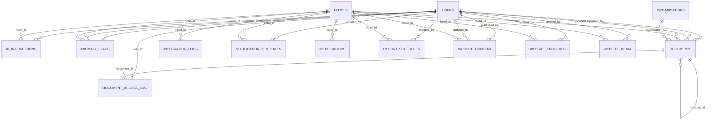

### ai_interactions

Defined in `0008_bi_ai_documents.sql`.

| Column | Type | Null | Default | Key / reference |
|---|---|---|---|---|
| id | INTEGER | no |  | PK |
| hotel_id | INTEGER | yes |  | → hotels |
| user_id | INTEGER | no |  | → users |
| question | TEXT | no |  |  |
| intents | TEXT | yes |  |  |
| engine | VARCHAR(20) | no |  |  |
| denied | TEXT | yes |  |  |
| answer | TEXT | yes |  |  |
| created_at | TEXT | no |  |  |

### anomaly_flags

Defined in `0008_bi_ai_documents.sql`. Unique: (hotel_id, fingerprint).

| Column | Type | Null | Default | Key / reference |
|---|---|---|---|---|
| id | INTEGER | no |  | PK |
| hotel_id | INTEGER | no |  | → hotels |
| rule | VARCHAR(50) | no |  |  |
| severity | VARCHAR(10) | no | 'medium' |  |
| entity_type | VARCHAR(30) | yes |  |  |
| entity_id | INTEGER | yes |  |  |
| business_date | TEXT | yes |  |  |
| amount | INTEGER | yes |  |  |
| user_id | INTEGER | yes |  | → users |
| title | VARCHAR(250) | no |  |  |
| explanation | TEXT | no |  |  |
| fingerprint | VARCHAR(120) | no |  |  |
| status | VARCHAR(20) | no | 'open' |  |
| reviewed_by | INTEGER | yes |  | → users |
| reviewed_at | TEXT | yes |  |  |
| review_note | TEXT | yes |  |  |
| created_at | TEXT | no |  |  |

### document_access_log

Defined in `0008_bi_ai_documents.sql`.

| Column | Type | Null | Default | Key / reference |
|---|---|---|---|---|
| id | INTEGER | no |  | PK |
| document_id | INTEGER | no |  | → documents |
| user_id | INTEGER | yes |  | → users |
| action | VARCHAR(20) | no |  |  |
| detail | TEXT | yes |  |  |
| ip | VARCHAR(64) | yes |  |  |
| created_at | TEXT | no |  |  |

### documents

Defined in `0008_bi_ai_documents.sql`. Unique: (storage_key).

| Column | Type | Null | Default | Key / reference |
|---|---|---|---|---|
| id | INTEGER | no |  | PK |
| organisation_id | INTEGER | no |  | → organisations |
| hotel_id | INTEGER | yes |  | → hotels |
| entity_type | VARCHAR(30) | no |  |  |
| entity_id | INTEGER | yes |  |  |
| category | VARCHAR(40) | no |  |  |
| title | VARCHAR(200) | no |  |  |
| filename | VARCHAR(200) | no |  |  |
| content_type | VARCHAR(100) | no |  |  |
| size_bytes | INTEGER | no |  |  |
| sha256 | VARCHAR(64) | no |  |  |
| storage_key | VARCHAR(100) | no |  |  |
| confidentiality | VARCHAR(20) | no | 'internal' |  |
| version | INTEGER | no | 1 |  |
| replaces_id | INTEGER | yes |  | → documents |
| retention_until | TEXT | yes |  |  |
| legal_hold | INTEGER | no | 0 |  |
| status | VARCHAR(20) | no | 'active' |  |
| notes | TEXT | yes |  |  |
| uploaded_by | INTEGER | yes |  | → users |
| created_at | TEXT | no |  |  |
| deleted_at | TEXT | yes |  |  |
| deleted_by | INTEGER | yes |  | → users |
| delete_reason | TEXT | yes |  |  |

### integration_logs

Defined in `0004_payments_finance_messaging.sql`.

| Column | Type | Null | Default | Key / reference |
|---|---|---|---|---|
| id | INTEGER | no |  | PK |
| hotel_id | INTEGER | yes |  | → hotels |
| integration | VARCHAR(30) | no |  |  |
| direction | VARCHAR(10) | no |  |  |
| endpoint | VARCHAR(300) | no |  |  |
| status_code | INTEGER | yes |  |  |
| attempt | INTEGER | no | 1 |  |
| ok | INTEGER | no | 0 |  |
| summary | VARCHAR(500) | yes |  |  |
| error | VARCHAR(500) | yes |  |  |
| created_at | TEXT | no |  |  |

### notification_templates

Defined in `0004_payments_finance_messaging.sql`. Unique: (hotel_id, code, channel).

| Column | Type | Null | Default | Key / reference |
|---|---|---|---|---|
| id | INTEGER | no |  | PK |
| hotel_id | INTEGER | no |  | → hotels |
| code | VARCHAR(40) | no |  |  |
| channel | VARCHAR(20) | no |  |  |
| subject | VARCHAR(200) | yes |  |  |
| body | TEXT | no |  |  |
| active | INTEGER | no | 1 |  |
| updated_by | INTEGER | yes |  | → users |
| updated_at | TEXT | yes |  |  |

### notifications

Defined in `0001_core.sql`.

| Column | Type | Null | Default | Key / reference |
|---|---|---|---|---|
| id | INTEGER | no |  | PK |
| hotel_id | INTEGER | yes |  | → hotels |
| channel | VARCHAR(20) | no |  |  |
| recipient | VARCHAR(200) | no |  |  |
| subject | VARCHAR(200) | yes |  |  |
| body | TEXT | no |  |  |
| status | VARCHAR(20) | no |  |  |
| error | VARCHAR(300) | yes |  |  |
| related_entity | VARCHAR(40) | yes |  |  |
| related_id | VARCHAR(40) | yes |  |  |
| created_at | TEXT | no |  |  |
| sent_at | TEXT | yes |  |  |
| read_at | TEXT | yes |  |  |
| attempts | INTEGER | no | 0 |  |

### report_schedules

Defined in `0008_bi_ai_documents.sql`.

| Column | Type | Null | Default | Key / reference |
|---|---|---|---|---|
| id | INTEGER | no |  | PK |
| hotel_id | INTEGER | no |  | → hotels |
| name | VARCHAR(150) | no |  |  |
| report_code | VARCHAR(50) | no |  |  |
| params | TEXT | yes |  |  |
| frequency | VARCHAR(10) | no |  |  |
| weekday | INTEGER | yes |  |  |
| month_day | INTEGER | yes |  |  |
| format | VARCHAR(5) | no | 'pdf' |  |
| recipients | TEXT | no |  |  |
| active | INTEGER | no | 1 |  |
| last_run_on | TEXT | yes |  |  |
| last_status | VARCHAR(30) | yes |  |  |
| last_error | TEXT | yes |  |  |
| created_by | INTEGER | no |  | → users |
| created_at | TEXT | no |  |  |

### website_content

Defined in `0013_website.sql`. Unique: (hotel_id).

| Column | Type | Null | Default | Key / reference |
|---|---|---|---|---|
| id | INTEGER | no |  | PK |
| hotel_id | INTEGER | no |  | → hotels |
| draft | TEXT | no |  |  |
| published | TEXT | yes |  |  |
| updated_by | INTEGER | yes |  | → users |
| updated_at | TEXT | no |  |  |
| published_by | INTEGER | yes |  | → users |
| published_at | TEXT | yes |  |  |

### website_enquiries

Defined in `0013_website.sql`.

| Column | Type | Null | Default | Key / reference |
|---|---|---|---|---|
| id | INTEGER | no |  | PK |
| hotel_id | INTEGER | no |  | → hotels |
| kind | VARCHAR(10) | no |  |  |
| name | VARCHAR(150) | no |  |  |
| email | VARCHAR(200) | no |  |  |
| phone | VARCHAR(50) | yes |  |  |
| subject | VARCHAR(200) | yes |  |  |
| message | TEXT | no |  |  |
| event_date | TEXT | yes |  |  |
| guests | INTEGER | yes |  |  |
| marketing_consent | INTEGER | no | 0 |  |
| status | VARCHAR(10) | no | 'new' |  |
| note | VARCHAR(500) | yes |  |  |
| handled_by | INTEGER | yes |  | → users |
| handled_at | TEXT | yes |  |  |
| ip | VARCHAR(64) | yes |  |  |
| created_at | TEXT | no |  |  |

### website_media

Defined in `0013_website.sql`.

| Column | Type | Null | Default | Key / reference |
|---|---|---|---|---|
| id | INTEGER | no |  | PK |
| hotel_id | INTEGER | no |  | → hotels |
| filename | VARCHAR(200) | no |  |  |
| content_type | VARCHAR(50) | no |  |  |
| caption | VARCHAR(150) | yes |  |  |
| size_bytes | INTEGER | no |  |  |
| created_by | INTEGER | no |  | → users |
| created_at | TEXT | no |  |  |

